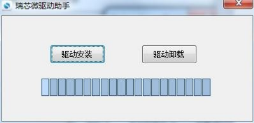

# Android Firmware Flashing

## Flash One Board over USB

1. Back up data and prepare the X3576BV3 Android `update.img`.
2. Install the supplied Rockchip USB driver and open AndroidTool.
3. Select the image on the Upgrade Firmware tab. Use the download-key procedure for the fitted board with a Type-C data cable and 12 V supply.
4. Start the upgrade once the tool detects the board. Wait for completion before rebooting, then verify display, touch, networking and storage.

Tools are under `RKTools/windows/`. Onboard keys are POWER, RESET and BOOT. Use the download combination for the actual board revision. If detection fails, check the Type-C data cable, supply, driver and download mode.

## Batch Upgrades

Extract the supplied `FactoryTool_v1.66.zip`, open FactoryTool, select the image for this board and start Upgrade. Put each board in download mode before connecting it and inspect the success or failure result for each port.

Android TF-card upgrades are unverified on this board. Use Type-C OTG for upgrades.
