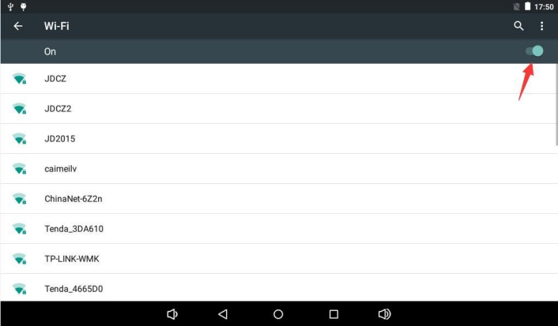
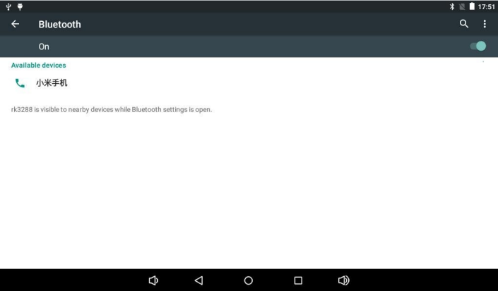

# Android User Guide

## UART and ADB

Start with 1500000 baud, 8N1 and no flow control on UART0 Debug. Use the firmware baud rate if it differs. Connect Type-C OTG for ADB, enable USB debugging in Developer options and authorize the host.

```bash
adb devices
adb shell
```

If multiple devices are attached, use `adb -s <serial> shell` to select the target.

## Networking and Bluetooth

Connect Wi-Fi in Settings under Network & Internet, or connect Ethernet and check the link and IP address. Discover devices under Connected devices and confirm pairing. Share files over Bluetooth or play media through a paired speaker.





## Display, Media and Storage

Connect a display to HDMI OUT or use a compatible MIPI DSI panel. Connect a camera to its matching CSI connector and check preview, photos and video in the camera app. Connect keyboards, mice and storage to a Host port. Detected TF and USB volumes appear under `/storage/` and can be used by media apps.

## Power and Controls

Press POWER briefly to suspend or wake, or hold it for shutdown controls. Use a compatible IR remote. Display rotation requires firmware configuration, and auto-rotation also depends on sensor and application support.
