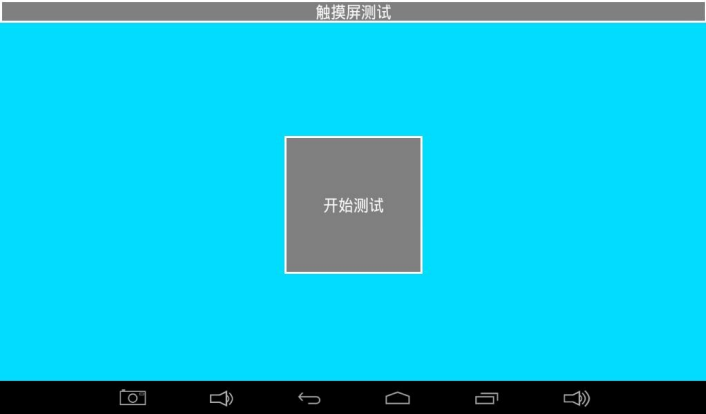
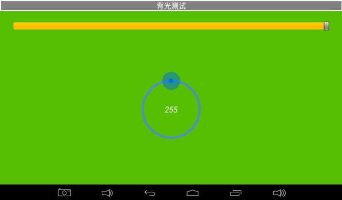
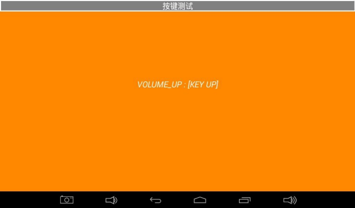
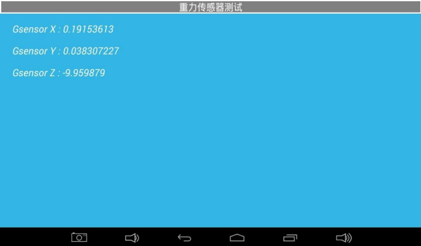
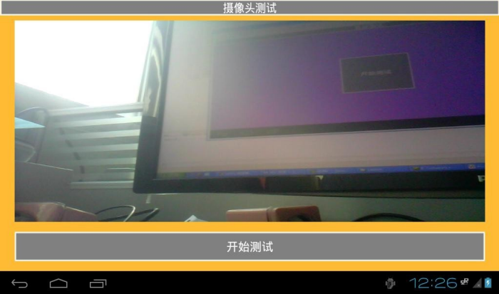
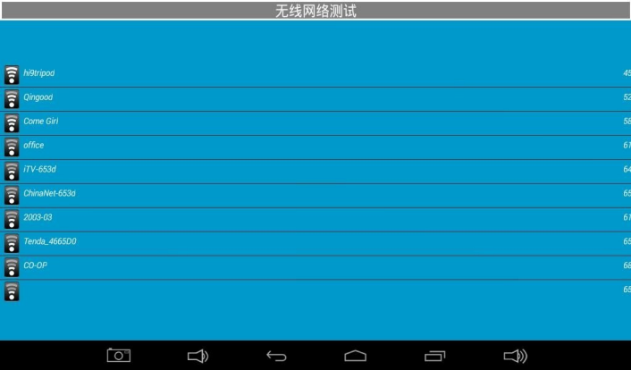
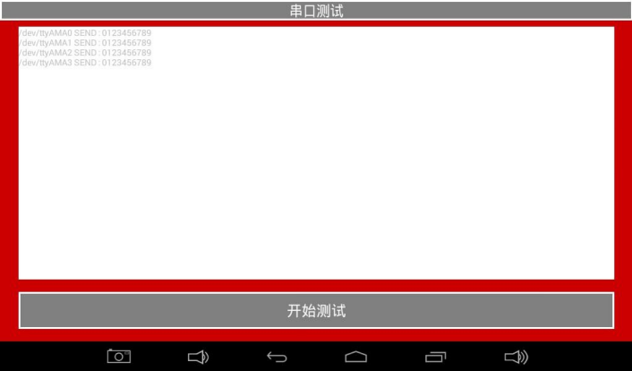
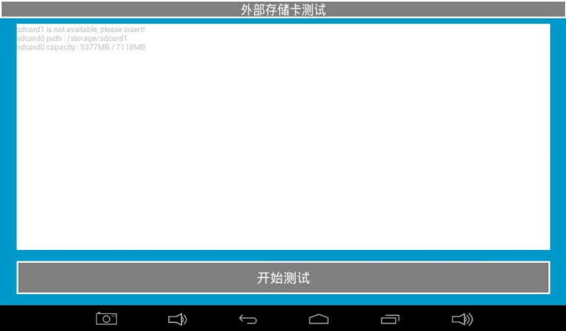

# Android Functional Tests

Open Android Test and swipe to switch tests. Select tests for the fitted hardware and firmware.

## Display and touch

Cycle solid colors to check dead pixels, missing colors and flicker. Draw diagonals and edge lines to check touch continuity.

## Backlight

Drag the control ring and observe brightness changes.

## Keys, LED and buzzer

Check press and release events. If fitted, use the LED or buzzer test page to check light or sound.

## Battery, ADC and sensors

Check fitted battery status, exposed ADC channels and orientation sensor readings.

## Audio and camera

Play a test tone and verify output. Connect a compatible camera and inspect preview.

## Networking

Check access points, the Ethernet link and network access.

## UART

Verify signal levels and pin order, loop TXD to RXD on the tested port, check for 0123456789 and remove the loopback afterward.

## TF and USB storage

Insert the medium and verify detection, mounting, capacity and file access.

