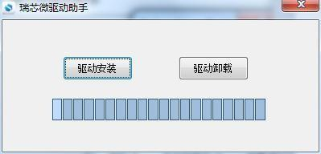

# Linux Firmware Flashing

## Flash over Type-C OTG

1. Back up data and prepare the X3576BV3 Linux `rockdev/update.img`.
2. Install the supplied Rockchip USB driver and open the tool under `RKTools/windows/AndroidTool/`.
3. Connect the Type-C OTG data cable. Confirm the RECOVERY key mapping for this revision. Hold RECOVERY, press and release RESET, and wait for Loader detection.
4. Select `update.img` on the Upgrade Firmware tab, start the upgrade and wait for writing to finish before rebooting.



## Download Modes and Troubleshooting

The board keys are marked POWER, RESET and BOOT. Confirm the recovery trigger for the board and firmware before using a RECOVERY combination. On a running system, use the command below if supported, or use Switch in the tool after it detects ADB.

```bash
reboot bootloader
```

If detection fails, check the 12 V supply, Type-C data cable and USB driver. If Loader is unavailable, use the Maskrom procedure for the board revision. Erase Flash clears storage data. Confirm backups and a recovery image before using it.
