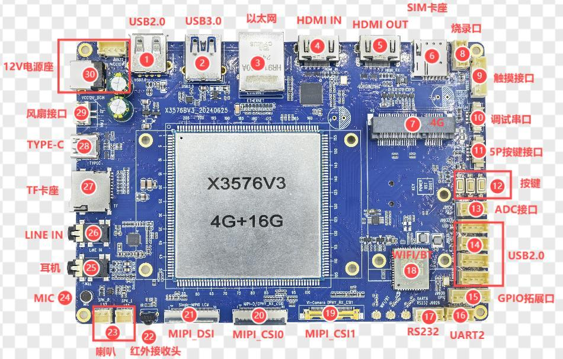

# Hardware Resources

| Callout | Interface | Purpose |
| --- | --- | --- |
| 1 | USB 2.0 | Type-A Host |
| 2 | USB 3.0 | Type-A Host |
| 3 | Ethernet | Gigabit RGMII |
| 4 | HDMI IN | Converted to MIPI by LT6911C |
| 5 | HDMI OUT | Native RK3576 output |
| 6 | SIM | Used with a 4G module |
| 7 | 4G PCIe | Expansion module |
| 8 | Programming header | LT6911C programming |
| 9 | Touch | 6-pin I2C touch connector |
| 10 | Debug | UART0 TTL debug |
| 11 | External keys | 5-pin header |
| 12 | Onboard keys | POWER, RESET and BOOT |
| 13 | ADC | 4-pin analog expansion |
| 14 | USB 2.0 | Four 4-pin headers |
| 15 | GPIO | 6-pin expansion header |
| 16 | TTL UART | Board marking UART2, circuit definition uses UART3 signals |
| 17 | RS232 | UART6 through MAX3232 |
| 18 | Wi-Fi/BT | VS2275P module |
| 19 | MIPI CSI1 | Camera connector |
| 20 | MIPI CSI0 | Camera connector |
| 21 | MIPI DSI | 30-pin display connector |
| 22 | IR | IR reception |
| 23 | Speaker | Stereo |
| 24 | MIC | Onboard recording input |
| 25 | Headset | Headphones and headset |
| 26 | LINE IN | Audio input |
| 27 | TF card | External storage |
| 28 | Type-C | OTG flashing and ADB |
| 29 | Fan | 12 V fan supply |
| 30 | Power | 12 V DC input |
