# Hardware Interfaces

## Power, Keys and Cooling

Use a 12 V / 3 A adapter. POWER, RESET and BOOT control startup, reset and download operations. Wire the 12 V fan according to the board markings. See Carrier Connector Pins for the external keys, power header and fan pinouts.

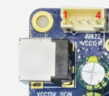

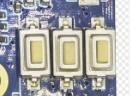

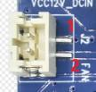

## Debug UART and Expansion

UART0 is the TTL debug port. The expansion header marked UART2 uses UART3 signals in the connector definition and has a 1.8 V reference supply. The RS232 header uses a MAX3232 and requires compatible RS232 equipment. Verify TTL levels before connecting, cross TX/RX and share ground.

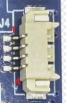

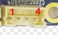

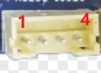

## USB and TF

Type-C OTG supports firmware download and ADB. The USB 3.0 Type-A port connects high-speed devices. A hub provides one USB 2.0 Type-A port and four 4-pin 2.0 mm headers. Use TF for external storage. Boot support depends on firmware.

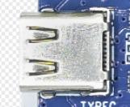

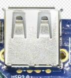

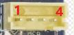

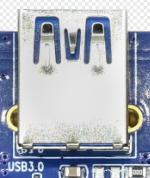

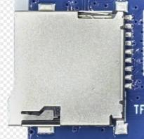

## Display, Cameras and Touch

HDMI OUT carries audio and video. HDMI IN is converted to MIPI by LT6911C. Use MIPI DSI for display and the 6-pin I2C header for touch, with 3.3 V or 1.8 V supply selection. CSI0 and CSI1 have different pinouts and supplies. Check every pin before attaching a module.

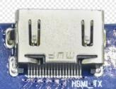

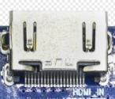

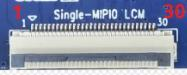

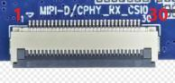

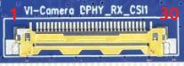

## Networking and 4G

RJ45 supports Gigabit Ethernet. The onboard VS2275P provides Wi-Fi 6 and Bluetooth. Use a compatible 4G module in the PCIe socket with a SIM, antenna and matching driver.

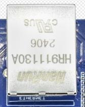

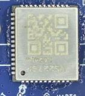

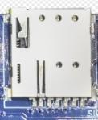

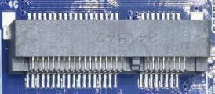

## Audio and IR

Connect headphones or an amplifier input to the headphone jack. LINE IN accepts audio input and the onboard microphone supports recording. Each speaker channel provides 0.5 W output. Use a matching remote with the IR receiver.

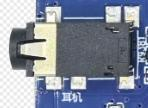

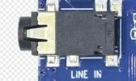

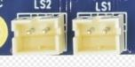

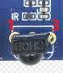
