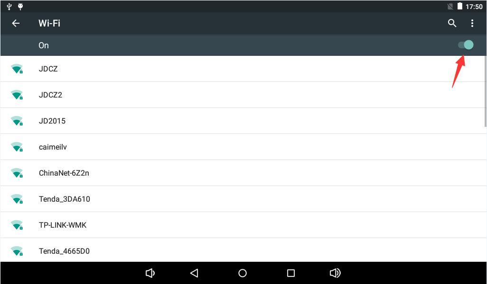
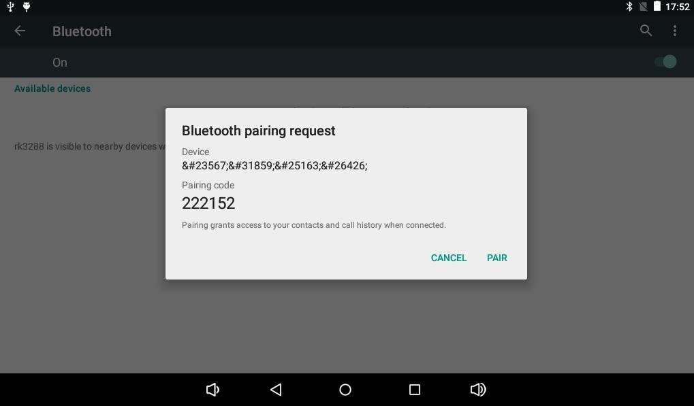
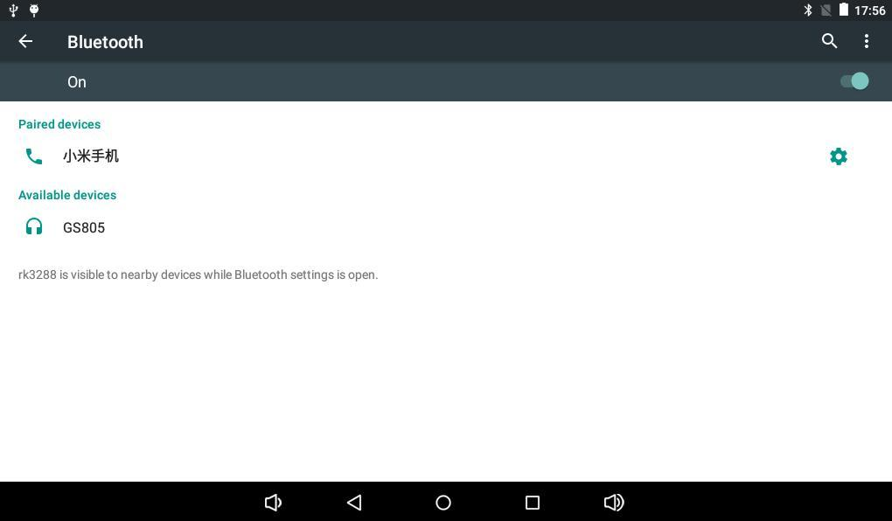

# Android User Guide

## UART and ADB

Connect UART0 through a USB-to-UART adapter at 115200-8-N-1 with flow control disabled. Cross TX/RX, share ground and verify the carrier interface levels. On Windows, select the COM port shown in Device Manager.

Enable Developer options → USB debugging in Android, connect Micro USB OTG and run on a host with ADB configured:

```bash
adb devices
adb shell
```

Enter `exit` to leave the board shell. With multiple devices connected, inspect serial numbers using `adb devices` and select one with `adb -s <serial> shell`.

## Networking and Bluetooth

Wi-Fi: open Settings → Network & Internet, enable Wi-Fi, select an access point and enter its password. Ethernet: connect an active cable and check link LEDs and IP settings. Bluetooth: open Connected devices → Bluetooth, discover a device and confirm pairing on both ends. Use Share → Bluetooth to send files; pair a Bluetooth speaker for media playback.







## Storage and Media

TF cards and USB storage mount under `/storage/` and are distinguished by UUID. Connect USB mice/keyboards to Host ports. The music application scans audio files; Gallery opens video and images.

## Display, Power and Suspend

Connect a monitor through Mini HDMI for video and audio; choose a resolution supported by the firmware. Applications supporting rotation follow the orientation sensor. After applying 12 V, the board starts automatically or requires holding POWER according to the firmware. Hold POWER for shutdown controls; short-press to suspend and press again to wake.
