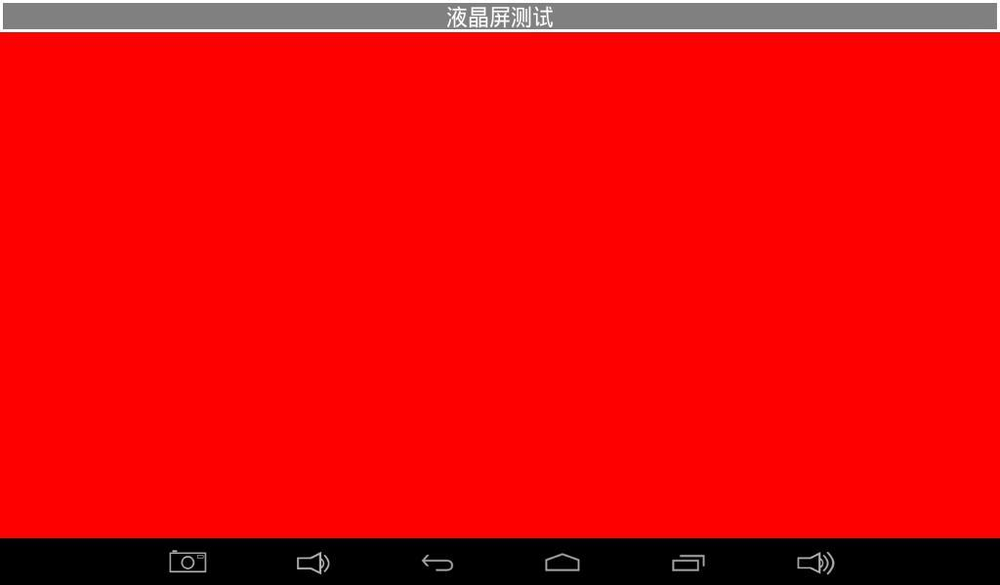
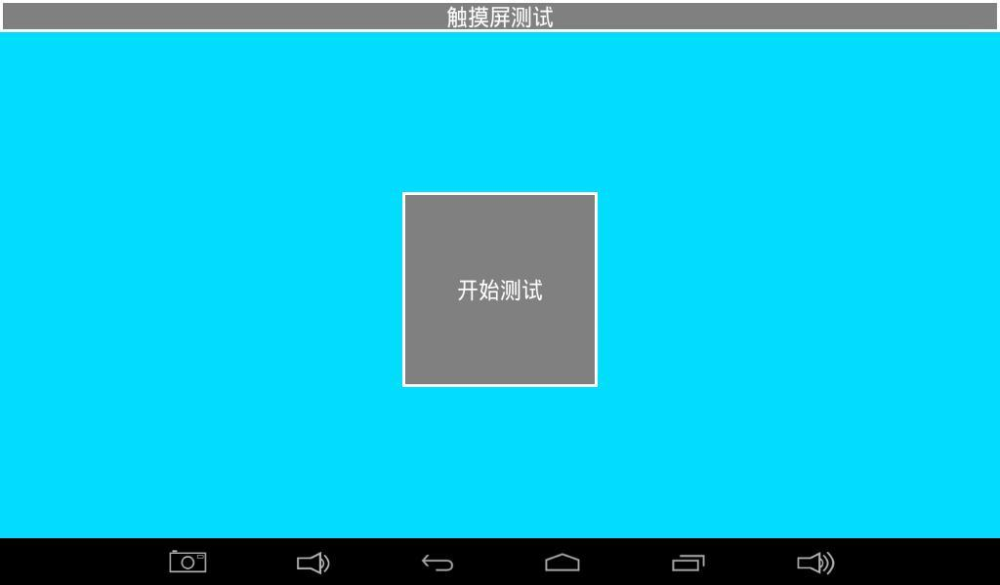
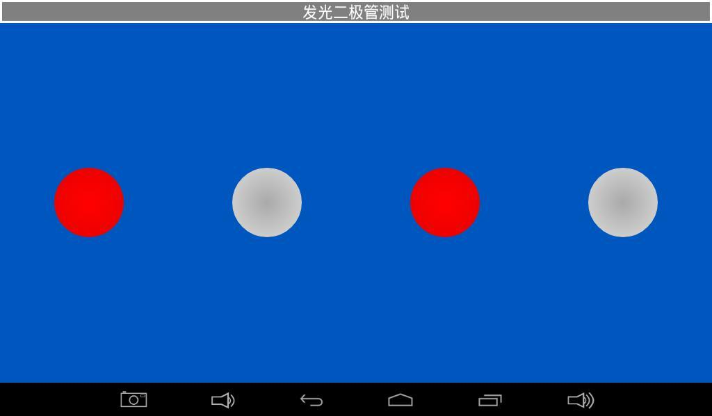
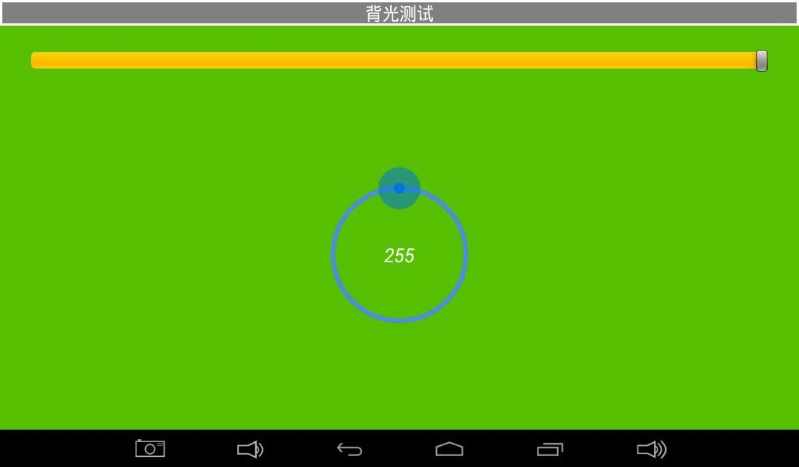
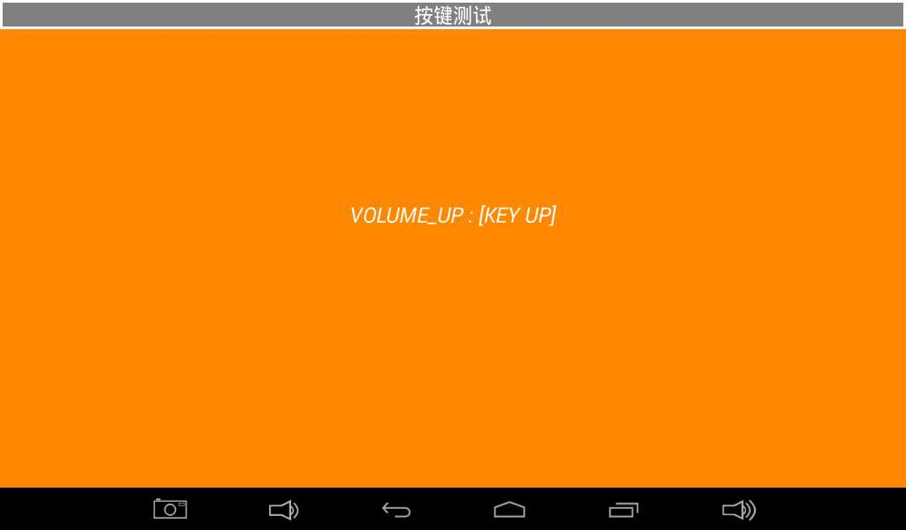
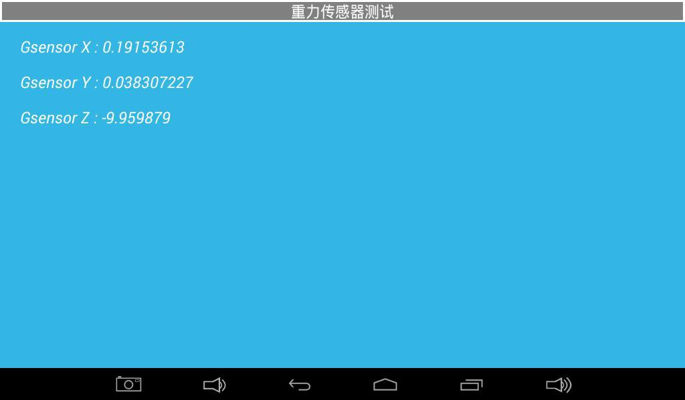
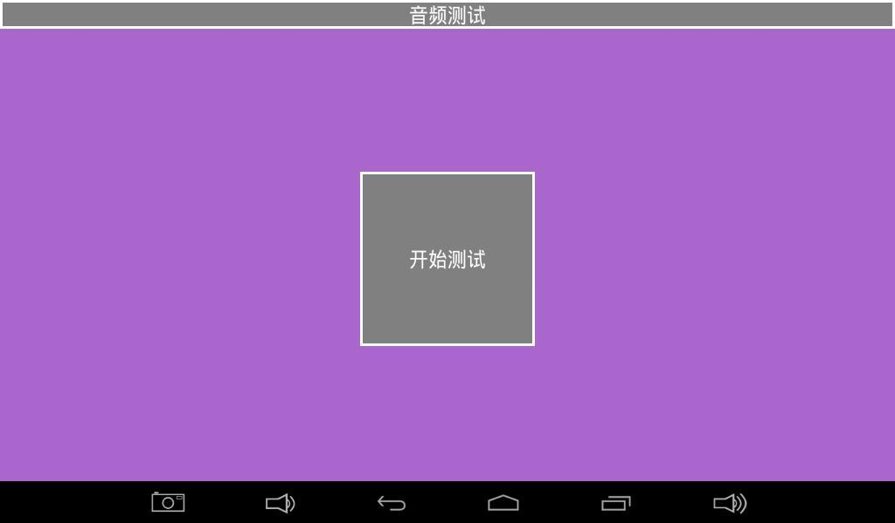
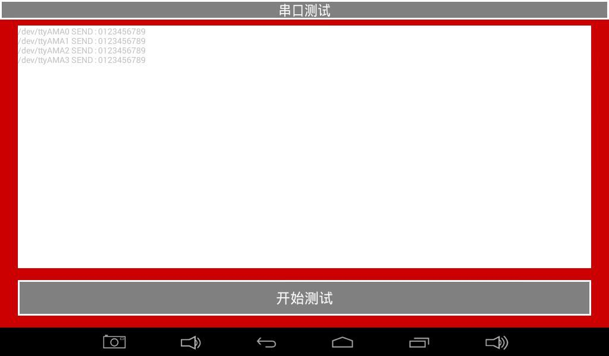
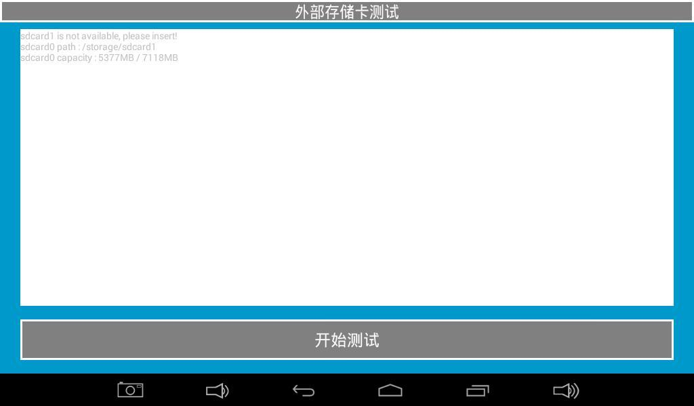

# Android Functional Tests

Open the Android Test application and swipe to change tests. Test only hardware fitted to this board and supported by its firmware; skip generic pages for unpopulated devices.

## LCD

Tap the solid-color area to cycle colors; inspect missing colors, bad pixels and flicker.

## Touch

Tap Start Test and draw diagonals and edge lines; check coordinates and continuity.

## LED and Buzzer

Toggle LED icons to check outputs. Hold Start Test on the buzzer page for sound and release to stop.

## Backlight

Drag the circular control and check continuous brightness changes.

## Keys and Battery

Press/release keys to inspect events; view battery level, voltage and power-source status.

## ADC and Orientation Sensor

Check voltages on the exposed ADC channels; rotate the board and observe X/Y/Z readings.

## Audio and Network

Start the audio test and listen for output; after connecting Wi-Fi/Ethernet, inspect access-point lists and web access.

## UART

After verifying interface levels, loop TXD to RXD, start the test and check that 0123456789 is received. Remove the loopback after testing.

## TF and USB Storage

Insert the medium and start the test; check capacity, mounting and file access.

