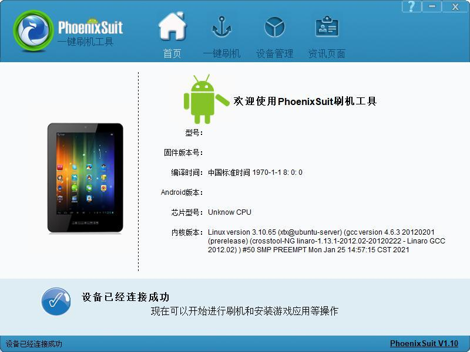
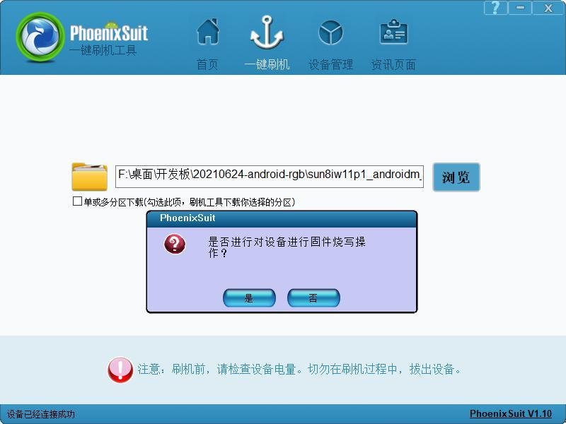
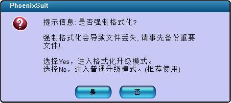
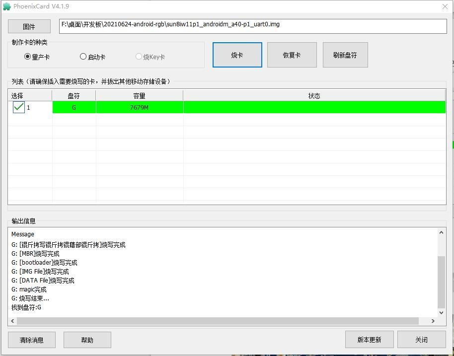
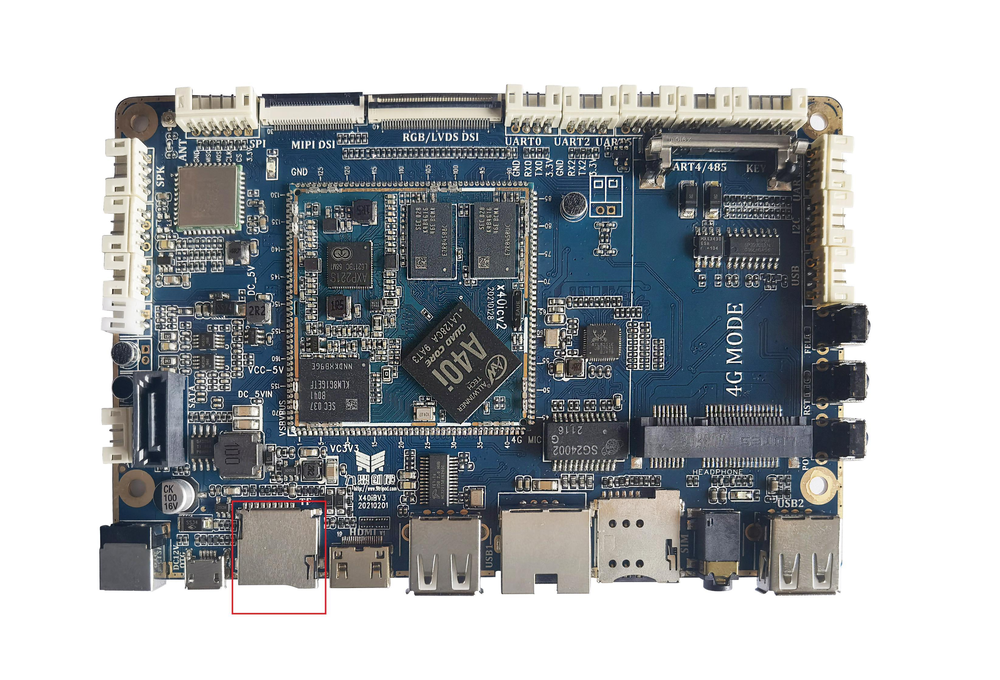

# Linux Firmware Flashing

## Prepare Tools and Firmware

Install the supplied PhoenixSuit and USB driver on Windows and select the Linux IMG. PhoenixSuit is under `x40i_linux/buildroot/tools_win/` and PhoenixCard under `x40i_linux/tools/tools_win/`. Back up required data before upgrading.

## USB Flashing

1. Connect the board Micro USB OTG port to the PC with a data cable and open PhoenixSuit.
2. Open the firmware-upgrade page and select the generated IMG.
3. Hold FEL while applying power, or hold FEL and briefly press RESET.
4. Wait for flashing to start. If a full-format upgrade is intended, accept the format prompt; this erases data.
5. Wait for success, boot normally and verify display and peripherals.

For Linux firmware, trigger the upgrade with FEL + RESET rather than the PhoenixSuit Upgrade Now button. Maintain power and USB connectivity throughout flashing.

## TF Upgrade Card

Open PhoenixCard, select the correct TF device and firmware, and create an upgrade card. Confirm card data can be erased before writing. Insert the card with the board powered off, apply power and wait for completion while monitoring progress or UART logs. Power off, remove the card and boot again.

