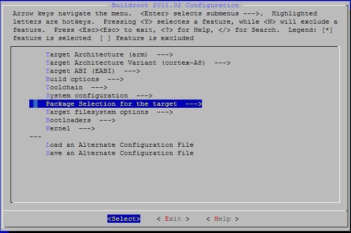
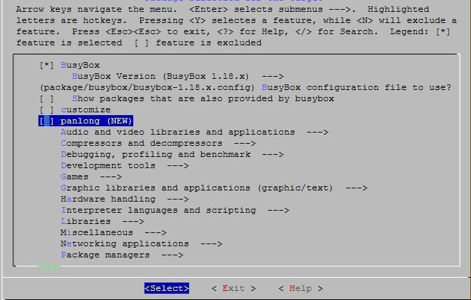

# Root Filesystem and Packages

## Integrate Files and Startup Scripts

`buildroot/target/user_rootfs_build.sh` runs during rootfs generation and copies `user_rootfs_extra/` into the target root. Place prebuilt libraries, configuration and utilities under the corresponding directories. Add driver loading and startup commands to `user_rootfs_extra/autorun.sh`.

`user_rootfs_misc/` contains projects requiring compilation or additional processing and is not automatically copied into rootfs. Add their build/copy steps to `user_rootfs_build.sh`. Common projects include `sdk/` and `ui_qt/`.

## SDK Library and Test Program

```bash
cd x40i_linux/buildroot/target/user_rootfs_misc/sdk
make cleanall
make
```

The build generates `libsdk.so` and `sdktest`. Install the library in `/usr/lib/` and the test program in `/` on the board. SDK directories include camera, cedarx, connectivity, display, storage, include, libs and tools.

## Add a Buildroot Package

1. Add `Config.in` and `<package>.mk` under `buildroot/package/<package>/`.
2. Include the package configuration from `buildroot/package/Config.in`.
3. Enable the package in the configuration menu, rebuild and package. Use fsck-msdos as an example for local source, argus for downloaded source and mali-3d for a binary package.

```text
source "package/panlong/Config.in"
```

Integrate kernel drivers under `linux-3.10/drivers/` where possible. Place external modules under `linux-3.10/modules/` and add build/clean rules in the matching `scripts/build_XX.sh`. Use `ARCH=arm` and `CROSS_COMPILE=arm-linux-gnueabi-`.




