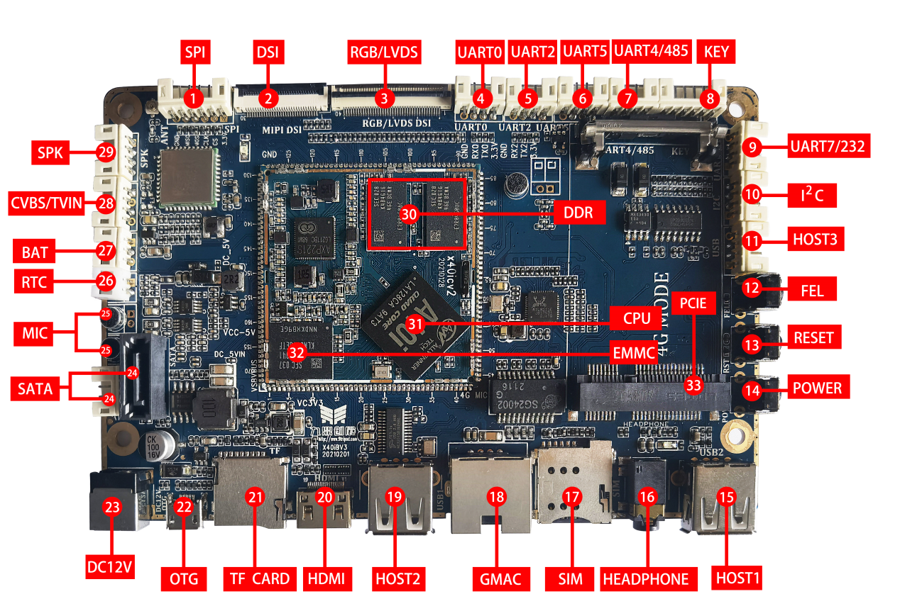

# Hardware Resources

| Callout | Name | Description |
| --- | --- | --- |
| 1 | SPI | SPI interface |
| 2 | DSI | DSI display |
| 3 | RGB/LVDS | RGB/LVDS display |
| 4 | UART0 | TTL; default debug UART |
| 5 | UART2 | TTL UART |
| 6 | UART5 | TTL or RS232 through resistor configuration |
| 7 | UART4/RS485 | TTL or RS485 through resistor configuration |
| 8 | KEY | 6-pin PH header for external keys |
| 9 | UART7 | TTL or RS232 through resistor configuration |
| 10 | I2C | I2C2, TTL levels |
| 11 | USB Host | PH-header Host port |
| 12 | FEL | Forced-download key |
| 13 | RESET | Hardware reset |
| 14 | POWER | Power key |
| 15 | USB Host | Type-A Host |
| 16 | Headphones | Headphone output |
| 17 | SIM | SIM for an external cellular module |
| 18 | GMAC | Gigabit Ethernet |
| 19 | USB Host | Type-A Host |
| 20 | HDMI | Type-C Mini HDMI |
| 21 | TF | TF card socket |
| 22 | OTG | USB download port |
| 23 | DC | 12 V DC input |
| 24 | SATA | SATA data and power |
| 25 | Microphones | Dual microphone inputs |
| 26 | RTC | External RTC battery |
| 27 | BAT | External battery supply |
| 28 | CVBS/TVIN | Composite video output / input |
| 29 | Speaker | External speaker output |
| 30 | DDR | Standard 1 GB DDR3 |
| 31 | CPU | Allwinner A40I, quad-core A7 |
| 32 | eMMC | Standard 8 GB; optional capacities |
| 33 | 4G expansion | Cellular module expansion socket |
| 34 | Camera | 24-pin parallel camera connector on the reverse side |

The socket marked PCIE is intended for a 4G communication module. Verify module communication, supply, SIM and antenna connections. UART electrical levels depend on fitted resistor options; check the assembly before wiring.
