# Hardware Interfaces

## Power Input

The carrier uses a 12 V DC input. Verify adapter polarity and current capacity before connecting.

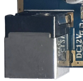

## Ethernet

Onboard RTL8211E provides Gigabit Ethernet. Connect an RJ45 cable and check link LEDs and the system IP address.

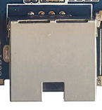

## TF Card

The TF socket supports storage expansion and upgrade cards. Creating an upgrade card overwrites card data; back it up first.

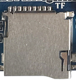

## Parallel Camera

The reverse side has a 24-pin parallel-camera connector. Check pins, voltages, clocks and driver support for a replacement module; carrier LDO configuration sets the required supplies.

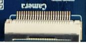

## TVIN/CVBS

Analog video input/output is exposed through a 4-pin PH header.

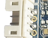

## SIM and 4G Expansion

Insert a compatible SIM and connect the required antenna when using a 4G module.

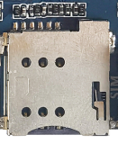

## FEL, POWER and Reset

FEL enters forced-download mode. If the board does not start automatically after power is applied, hold POWER to start. In Android, a short press suspends/wakes the system and a long press opens shutdown controls. RESET performs a hardware reset.

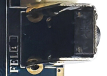

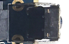

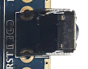

## External Keys

The 6-pin PH header exposes power, reset and download key signals. Verify the pin order against the schematic.

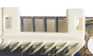

## UART0/2/4/5

UART0 is the default debug port and UART2 is TTL. UART4 supports TTL/RS485 and UART5 supports TTL/RS232 through carrier resistor configuration.

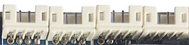

## UART7, I2C2 and USB Host

From top to bottom: UART7, I2C2 and USB Host. UART7 supports TTL/RS232, I2C2 uses TTL levels and USB Host is exposed through a PH header.

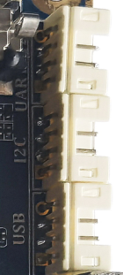

## Audio, Battery and RTC

From top to bottom: SPK, CVBS/TVIN, BAT and RTC. Verify battery voltage and polarity; the RTC battery maintains time when main power is removed.

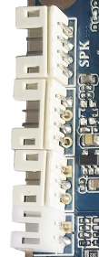

## LCD and HDMI

LCD connectors support MIPI and RGB/LVDS panels. Use matching cables, supplies and panel parameters. HDMI uses a Type-C Mini HDMI connector.

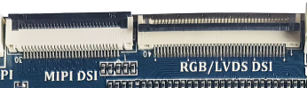

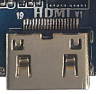

## USB Host and OTG

The outer Type-A connectors are USB 2.0 Host ports. Micro USB OTG is used for flashing and ADB and can operate as Host when configured by the firmware.

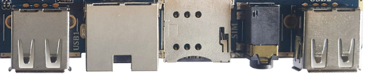

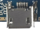

## Wi-Fi/BT

The board carries a 2.4 GHz SDIO Wi-Fi/BT module. Match its drivers and firmware to the fitted device.

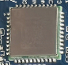

## SATA

The left PH header provides SATA power and the right connector carries SATA data. Check supply capacity and pin order before connecting a disk.

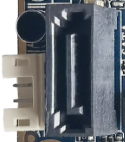

## 4G Module Socket

Use this socket with a supported communication module, SIM, antenna and matching driver.

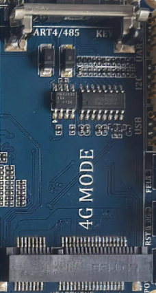
