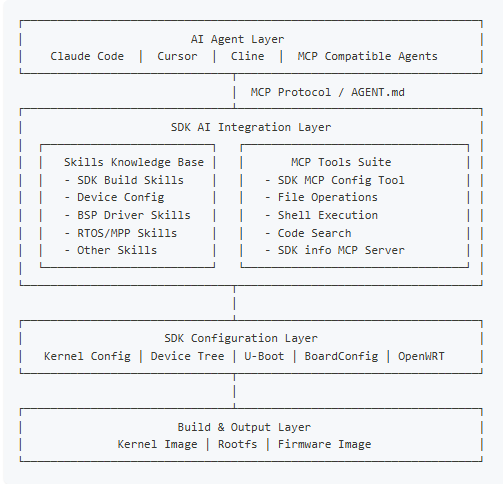

# SDK AI-assisted development

The SDK manual describes `AGENT.md`, `skills/` and MCP integration for SDK knowledge lookup, log analysis, configuration editing and confirmed build tasks. Availability depends on those files and services being included in the delivered SDK.



```text
AGENT.md
skills/
  sdk/
  device/v861/
  bsp/
  melis/
  eyesee-mpp/
```

Provide board model, SDK version, target function and error logs, then have the tool retrieve relevant SKILL.md files before proposing edits and validation. These are ordinary SDK technical documents accessed through the SDK retrieval configuration.

Review device-tree, Kconfig, Makefile and script changes before submission and verify builds and hardware functions. AI analysis does not replace checking pins, voltage levels and waveforms on the board.
