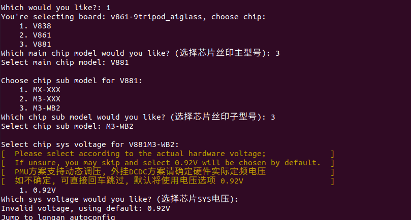
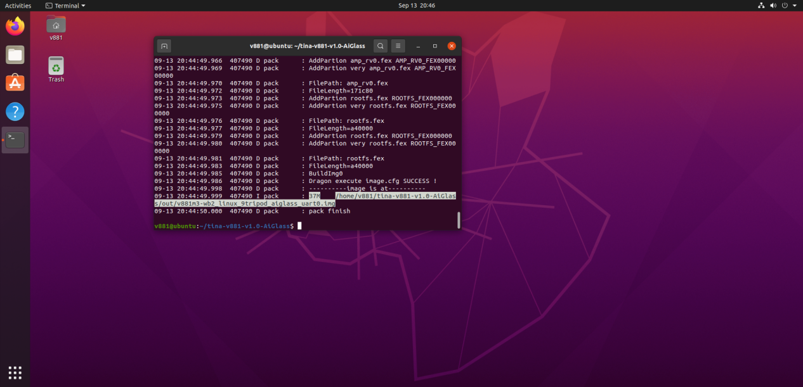
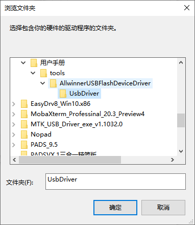
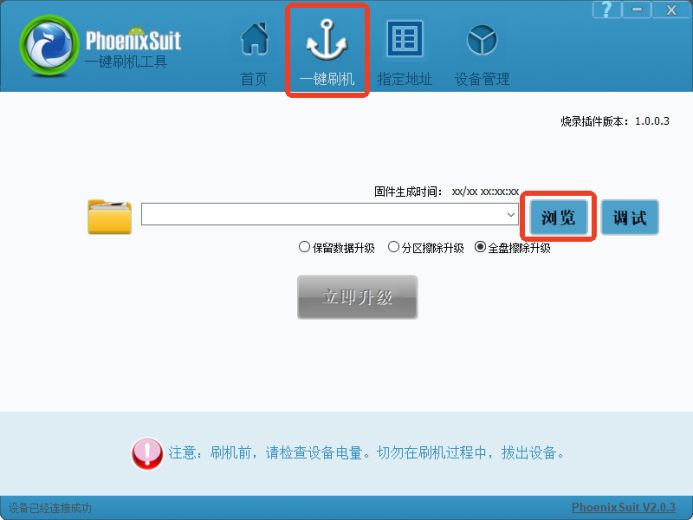
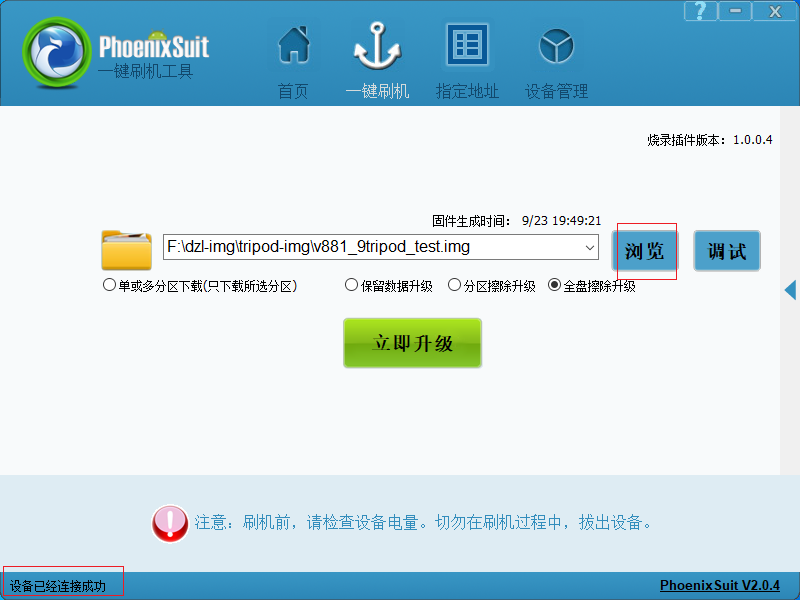
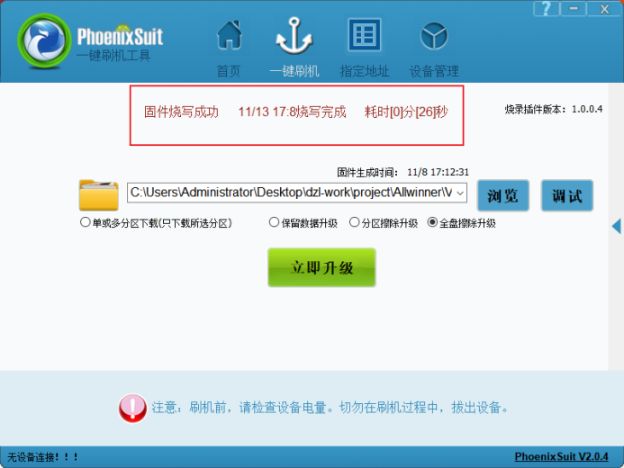

# Build and flash

## Extract and build

```bash
tar -xzvf tina-v881-v1.0.tar.gz
# Enter the extracted SDK directory
ls
tree -L 1
cat README.txt
source build/envsetup.sh
lunch
# Select v861-9tripod_aiglass-tina
m -j4
pack
```

On first board selection, read and confirm the license prompt. `m` / `make` build the SDK; `mp -j4` builds and packages. Use the image path printed in the success log.





## PhoenixSuit driver and flashing

1. Install PhoenixSuit and the Allwinner USB driver on Windows.
2. For an unknown device in Device Manager, update its driver from `UsbDriver`.
3. Open one-click flashing, select the generated `.img` and the project erase/upgrade option.
4. The X881 manual starts flashing after USB connection and the tool reports the device connected.
5. Wait for flashing success, restart and inspect UART logs.









Flashing overwrites system data. If detection fails, check the data cable, power, driver and boot state. Use the recovery entry method specified for the delivered board.
