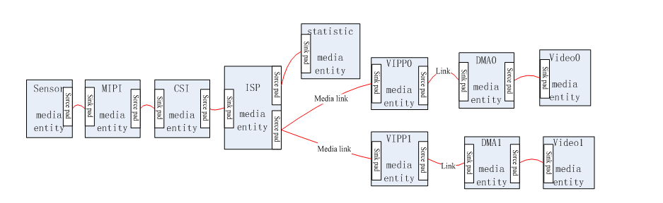

# Camera driver adaptation

X881 exposes a 20-pin MIPI CSI camera connector. Start adaptation with hardware, power and sensor ID, then verify MIPI reception, VIN, ISP and encoding.



```text
bsp/drivers/vin/
bsp/drivers/vin/modules/sensor/
bsp/drivers/vin/modules/actuator/
bsp/drivers/vin/modules/flash/
```

- Verify supply voltages, MCLK, reset, PWDN and power-sequence delays.
- Read the sensor ID over I2C.
- Set lane count/order, RAW/YUV format, clock and data rate.
- Bind the sensor, I2C address, GPIO and supplies in the active board.dts.
- Confirm VIN/ISP linkage and frames before tuning exposure, gain, color or encoding.

```bash
dmesg | grep -i -E 'sensor|vin|isp|mipi'
ls -l /dev/video*
```

Reference drivers include `gc1084_mipi.c` and `gc2053_mipi.c`; select the actual sensor. Verify generic platform parallel-input and resolution limits against the V881 SDK.
