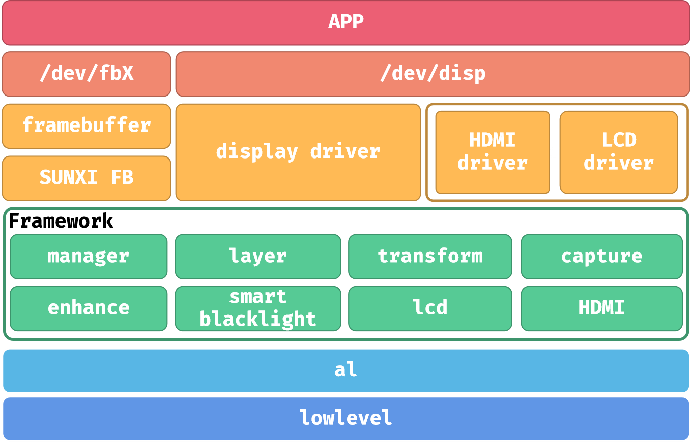
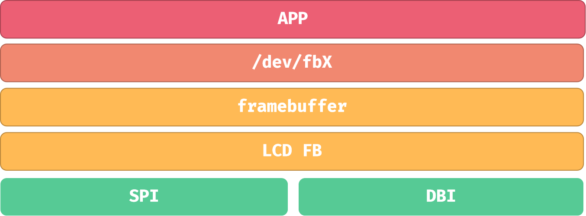
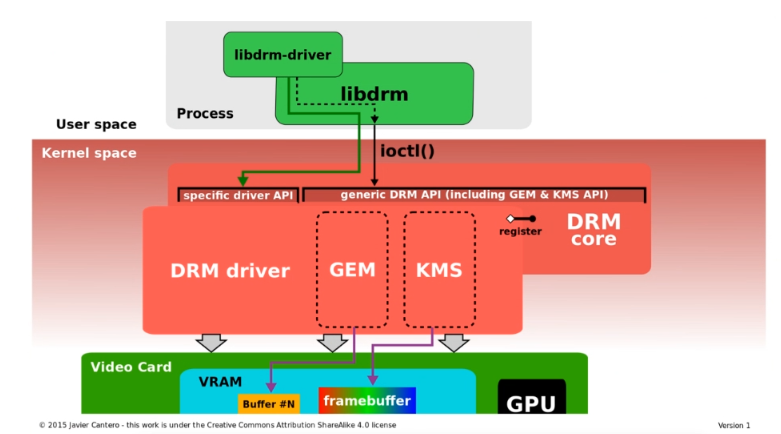
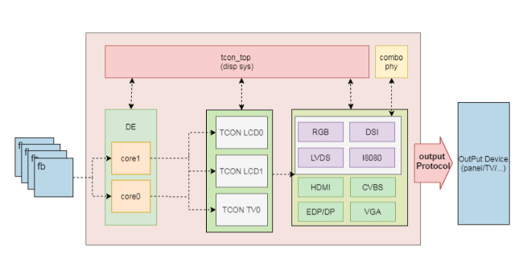

# LCD and DRM display

The X881 physical display connection is DBI, with an adapter for SPI panels. The software manual covers DISP, LCD_FB, FBTFT and DRM; select the path supported by the kernel and panel.





LCD_FB sends RGB framebuffer data to SPI/DBI and cannot directly display YUV. FBTFT is the kernel SPI-panel path. Check panel power, backlight, RESET, CS/DC and SPI mode before initialization commands, RGB/BGR ordering, resolution and refresh timing.

## DRM components and source





```text
kernel/drivers/gpu/drm/
bsp/drivers/drm/
bsp/drivers/drm/sunxi_drm_drv.c
bsp/drivers/drm/sunxi_drm_crtc.c
```

Framebuffer stores pixels, Plane represents a layer, CRTC drives scanout and Encoder/Connector represent output encoding and connections. libdrm uses atomic commits to configure state. HDMI/eDP/LVDS shown in generic diagrams are not additional exposed X881 connectors.
