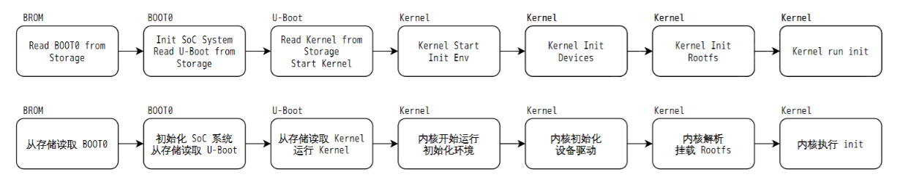
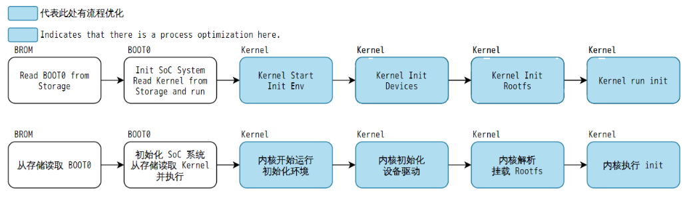

# FASTBOOT quick-start system

FASTBOOT here means the Tina quick-start configuration: BOOT0 loads the optimized kernel and device tree directly, bypassing normal U-Boot.

Normal: BROM → BOOT0 → U-Boot → Kernel/DTB → rootfs/init. Quick-start: BROM → BOOT0 → Kernel/DTB → optimized rootfs/init. Driver and application initialization still affect time to readiness.

Without U-Boot, its automatic OTA, display logo, dynamic boot-media selection and NFS boot paths are unavailable; the manual also excludes card flashing. Confirm update, recovery, display and production-test paths before selecting quick-start.
