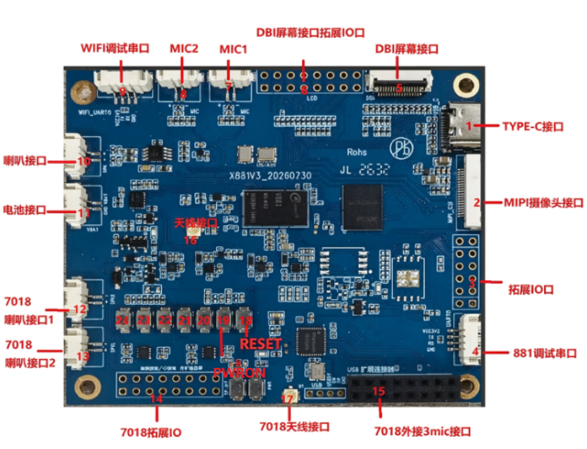

# Hardware resources

| Number | Name | Description |
| --- | --- | --- |
| 1 | Type-C | 24-pin Type-C connector |
| 2 | MIPI camera | 20-pin camera connector |
| 3 | Expansion I/O | Unused V881 GPIO pins |
| 4 | V881 debug UART | 4-pin, 1.25 mm right-angle SMT debug UART connector |
| 5 | DBI display | 16-pin, 0.5 mm FPC DBI connector |
| 6 | DBI expansion I/O | 2X8X2.54mm |
| 7 | MIC1 | 2-pin, 1.25 mm right-angle SMT connector to the main processor |
| 8 | MIC2 | 2-pin, 1.25 mm right-angle SMT connector to the main processor |
| 9 | Wi-Fi debug UART | 4-pin, 1.25 mm right-angle SMT connector |
| 10 | Speaker | 2-pin, 1.25 mm right-angle SMT speaker connector, 4 Ω / 3 W by default |
| 11 | Battery | 2-pin, 1.25 mm right-angle SMT connector |
| 12 | JL7018 speaker 1 | 2-pin, 1.25 mm right-angle SMT connector to JL7018 |
| 13 | JL7018 speaker 2 | 2-pin, 1.25 mm right-angle SMT connector to JL7018 |
| 14 | JL7018 expansion I/O | 2X8X2.54mm |
| 15 | JL7018 external three-microphone connector | 2 × 8, 2.54 mm female header |
| 16 | Antenna | Connect an external antenna for Bluetooth/network use |
| 17 | JL7018 antenna | JL7018 external antenna connector |
| 18 | RESET | V881 reset button |
| 19 | PWRON | V881 suspend button |

## Power and signal ownership

- Type-C provides charging, power, flashing and ADB.
- Connect a single-cell 3.7 V lithium battery with the correct polarity and rating.
- V881 provides two microphones and one speaker; JL7018 provides three microphones and two speakers through expansion circuitry.
- V881 and Wi-Fi have separate debug UARTs; match the console baud rate to its boot stage.
- An external DBI-to-SPI adapter connects the display; touch controls are exposed on the DBI connector.
