# Interface definitions

## Type-C

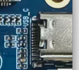

USB Type-C for charging, power, firmware download and ADB

## MIPI camera

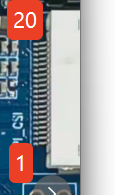

One MIPI camera connector for environment recognition and photography

| Pin | Signal | Pin | Signal |
| --- | --- | --- | --- |
| 1 | MIPI-CSI-D0P | 11 | GND |
| 2 | MIPI-CSI-D0N | 12 | TWI0-SCK |
| 3 | GND | 13 | TWI0-SDA |
| 4 | MIPI-CSI-D1P | 14 | MIPI-CSI-RSTN0 |
| 5 | MIPI-CSI-D1N | 15 | GND |
| 6 | GND | 16 | LDOB-2V8 |
| 7 | MIPI-CSI-CKP | 17 | LDOB-2V8 |
| 8 | MIPI-CSI-CKN | 18 | VCC-1V8 |
| 9 | GND | 19 | VCC-1V2 |
| 10 | MIPI-CSI-MCLK0 | 20 | NC |

## V881 expansion I/O

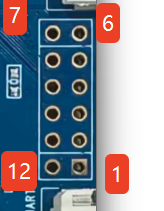

Unused V881 GPIO pins

| Pin | Signal | Pin | Signal |
| --- | --- | --- | --- |
| 1 | L22 | 7 | K23 |
| 2 | M21 | 8 | K19 |
| 3 | L21 | 9 | J19 |
| 4 | K21 | 10 | L19 |
| 5 | L20 | 11 | K22 |
| 6 | K20 | 12 | GND |

## V881 debug UART

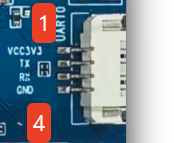

Four-pin UART connector

| Pin | Signal |
| --- | --- |
| 1 | VCC3.3 |
| 2 | TX |
| 3 | RX |
| 4 | GND |

## DBI display

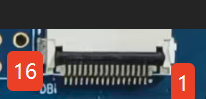

DBI connector; connects to an SPI panel through an adapter

| Pin | Signal | Pin | Signal |
| --- | --- | --- | --- |
| 1 | VCC33-STB | 9 | PD6-DBI-TE |
| 2 | VCC33-STB | 10 | GND |
| 3 | GND | 11 | PH15-LCD-PWM |
| 4 | PD1-DBI-CSX | 12 | GND |
| 5 | PD2-DBI-SCLK | 13 | PD19-TWI3-SDA |
| 6 | PD3-DBI-SDO | 14 | PD18-TWI3-SCK |
| 7 | PD4-DBI-SDI | 15 | PD21-CTP-INT |
| 8 | PD5-DBI-DCX | 16 | PD20-CTP-RESET |

## DBI expansion I/O

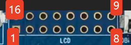

Unused V881 GPIO pins

| Pin | Signal | Pin | Signal |
| --- | --- | --- | --- |
| 1 | PD2-LCD-D4 | 9 | PD6-LCD-D10 |
| 2 | PD18-LCD-CLK | 10 | VCC33 |
| 3 | PD3-LCD-D5 | 11 | PD7-LCD-D11 |
| 4 | PD20-LCD-HSYNC | 12 | GND |
| 5 | PD4-LCD-D6 | 13 | PD1-LCD-D3 |
| 6 | PD21-LCD-VSYNC | 14 | PD19-LCD-DE |
| 7 | PD5-LCD-D7 | 15 | PH15-LCD-PWM |
| 8 | PD8-LCD-D12 | 16 | GND |

## MIC1

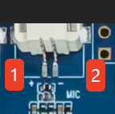

Two-pin, 1.25 mm microphone connector to V881

| Pin | Signal |
| --- | --- |
| 1 | MIC+ |
| 2 | MIC- |

## MIC2

Two-pin, 1.25 mm microphone connector to V881

| Pin | Signal |
| --- | --- |
| 1 | MIC+ |
| 2 | MIC- |

## Wi-Fi debug UART

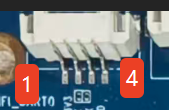

Four-pin UART connector for Wi-Fi debugging

| Pin | Signal |
| --- | --- |
| 1 | VCC3.3 |
| 2 | TX |
| 3 | RX |
| 4 | GND |

## V881 speaker

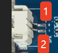

Two-pin, 1.25 mm speaker connector

| Pin | Signal |
| --- | --- |
| 1 | SPK+ |
| 2 | SPK- |

## Battery

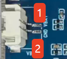

Two-pin, 1.25 mm connector for a 3.7 V lithium battery

| Pin | Signal |
| --- | --- |
| 1 | VBAT |
| 2 | GND |

## JL7018 speaker 1

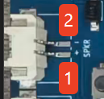

Two-pin, 1.25 mm speaker connector controlled by JL7018K

| Pin | Signal |
| --- | --- |
| 1 | SPK+ |
| 2 | SPK- |

## JL7018 speaker 2

Two-pin, 1.25 mm speaker connector controlled by JL7018K

| Pin | Signal |
| --- | --- |
| 1 | SPK+ |
| 2 | SPK- |

## JL7018 expansion I/O

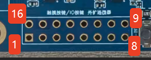

JL7018 GPIO pins

| Pin | Signal | Pin | Signal |
| --- | --- | --- | --- |
| 1 | POW5V | 9 | TP-SDA |
| 2 | POW5V | 10 | TP-SCL |
| 3 | POW5V | 11 | BT-PWR-KEY |
| 4 | FLED- | 12 | BT-IOVDD3V |
| 5 | FLED- | 13 | GND |
| 6 | GND | 14 | SPKL+ |
| 7 | TP-INT | 15 | SPKL- |
| 8 | TP-RST | 16 | GND |

## JL7018 external three-microphone interface

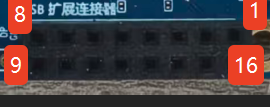

JL7018 external three-microphone interface

| Pin | Signal | Pin | Signal |
| --- | --- | --- | --- |
| 1 | NC | 9 | BT-MICIN2P |
| 2 | USBVBUS5V | 10 | BT-MICIN2N |
| 3 | BT-TX | 11 | BT-MICIN1P |
| 4 | USBVBUS5V | 12 | BT-MICIN1N |
| 5 | VBT-RX | 13 | GND |
| 6 | BT-MICLDO | 14 | GND |
| 7 | GND | 15 | BT-MICIN0P |
| 8 | DCDC3-3V3 | 16 | BT-MICIN0N |

## V881 antenna

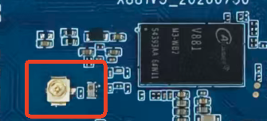

V881 Wi-Fi antenna connection; the radio specifications list 2.4 GHz and 5 GHz bands

## JL7018 antenna

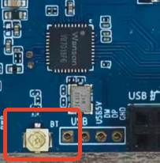

JL7018 2.4 GHz antenna connection, as described in the hardware manual

Wire UART according to TX/RX/GND markings; do not use its 3.3 V pin as an external power input. Verify pin order, voltages and firmware support before connecting cameras, displays or audio adapters.

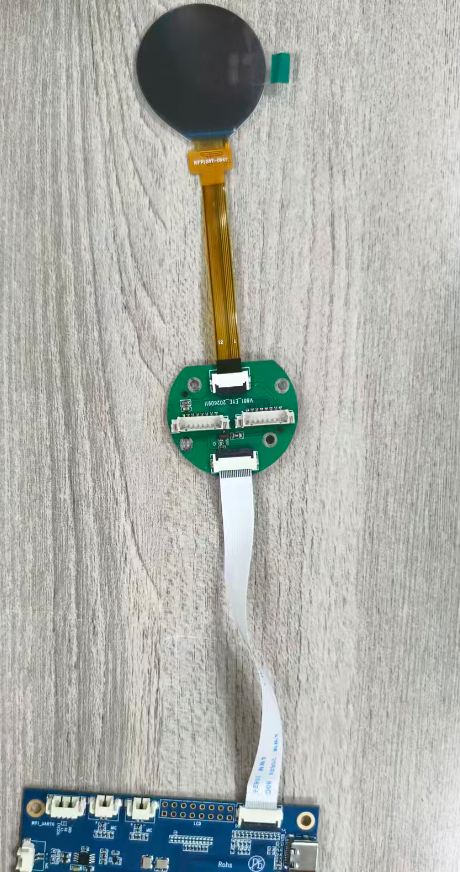
