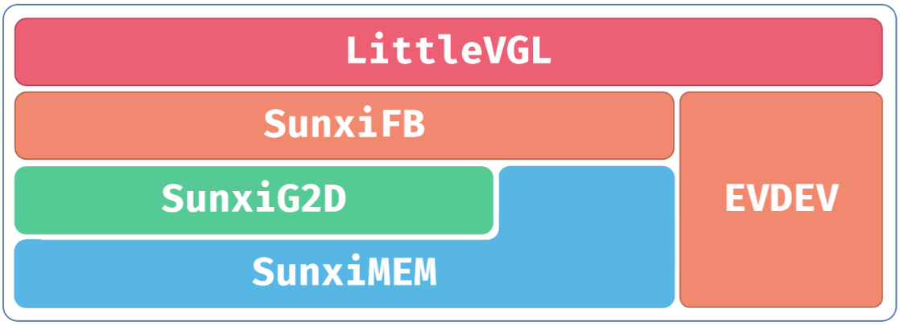

# LVGL and graphics acceleration

The manual uses LVGL 8.3.2, sunxifb/sunximem and evdev, under `platform/thirdparty/gui/lvgl-8`.



```bash
make menuconfig
# Gui -> Littlevgl -> lv_examples
lv_examples 0
lv_examples 1
lv_examples 2
lv_examples 3
lv_examples 4
```

Demo numbers select widgets, music, benchmark, keypad_encoder and stress. Select double buffering, cache, G2D and direct mode according to chip/driver support rather than copying another platform configuration.

```text
platform/thirdparty/gui/lvgl-8/lv_drivers/display/sunxifb.c
platform/thirdparty/gui/lvgl-8/lv_drivers/display/sunxigmem.c
platform/thirdparty/gui/lvgl-8/lv_drivers/indev/evdev.c
platform/thirdparty/gui/lvgl-8/lv_examples/src/lv_drv_conf.h
```

`sunxifb_init` initializes display, `sunxifb_flush` handles draw/back/front buffers and `sunxifb_get_sizes` obtains resolution. G2D requires the driver-supported contiguous physical buffers or file descriptors, with allocation and cache maintenance. Select touch through `EVDEV_NAME`.

```bash
ln -s /dev/input/eventX /dev/input/touchscreen
```

Replace eventX with the actual touch node. SPI bandwidth can limit refresh; reduce full-screen copies and image caches and measure render time separately from transfer time.
