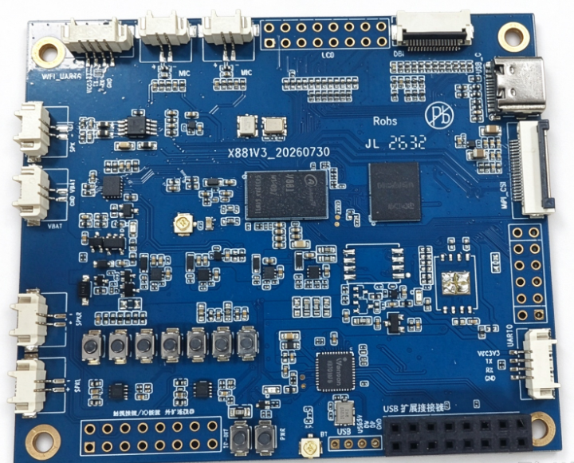
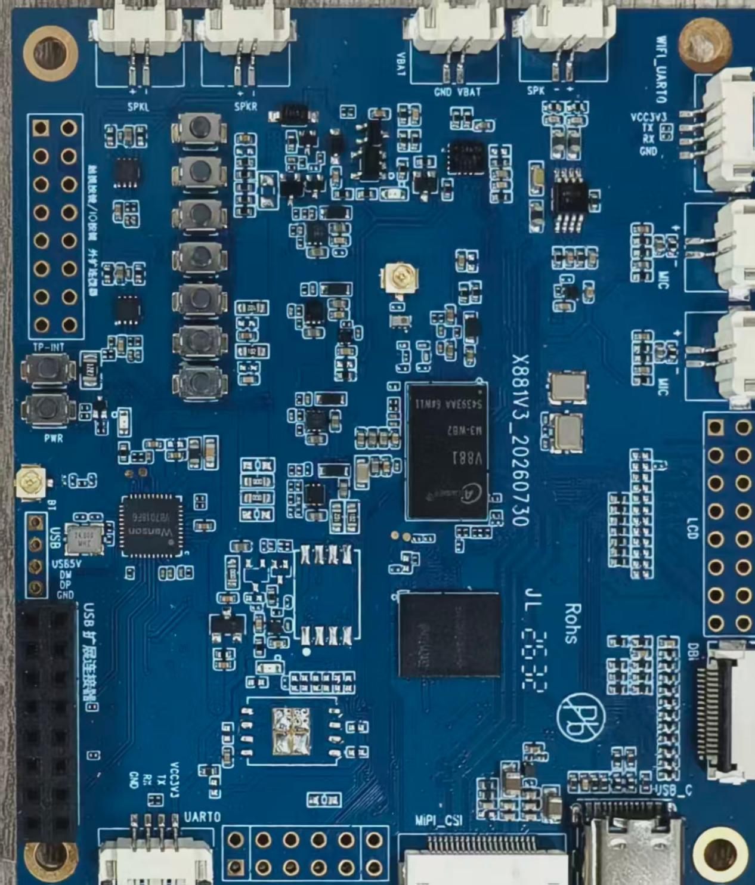
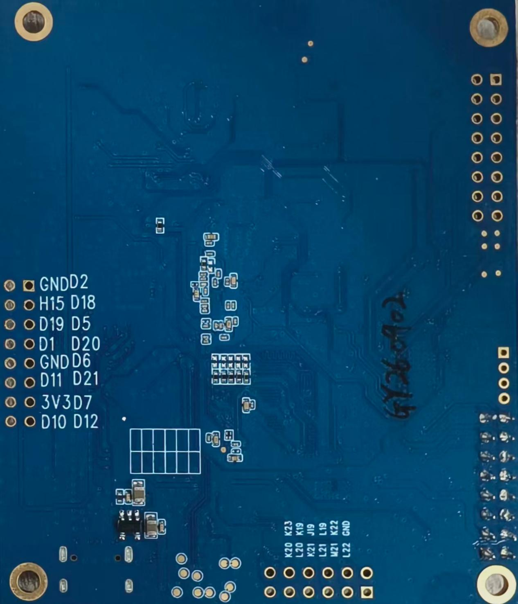
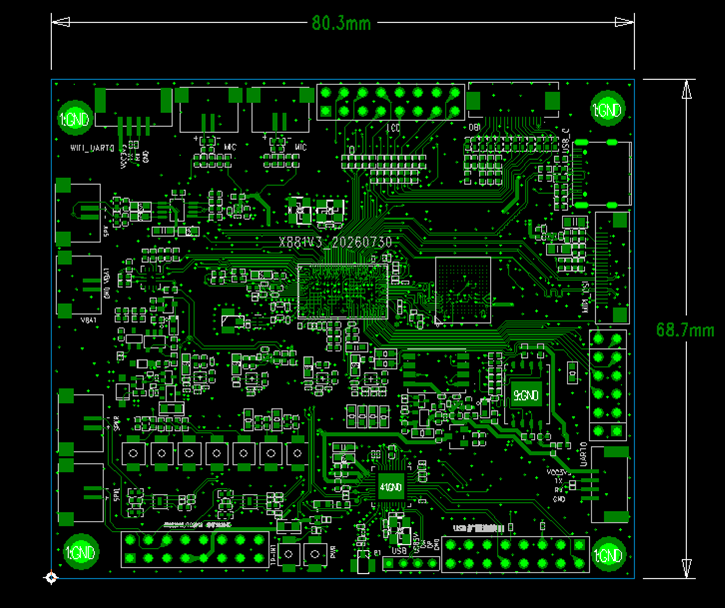

# Product introduction

X881 is an Allwinner V881 AI-glasses mainboard from JiuDing, paired with JL7018 for low-power wake-up. Applications include voice/vision interaction, AI streaming cameras, handheld cameras and industrial vision terminals.

AI-ISP, H.264/H.265 encoding, 8 MP video, EIS and focus acceleration are processor capabilities. This board exposes one MIPI camera and one DBI display connection and includes a six-axis IMU.

## V881 and JL7018 functions

| Item | Description |
| --- | --- |
| CPU | V881M3-WB2 |
| ROM | External 4 GB eMMC |
| Camera | One MIPI camera interface |
| Speaker | One 2-pin, 1.25 mm speaker connector, 4 Ω / 3 W |
| Microphones | Two 2-pin, 1.25 mm microphone connectors |
| LCD | One DBI display interface for an SPI panel through an external adapter |
| Battery | External battery, up to 4.2 V |
| Imu | Onboard 6-axis IMU |
| WIFI | 2.4GHz:20/40MHz,5GHz:20/40/80MHz |
| BT | BLE |

| Item | Description |
| --- | --- |
| Mic | Three external microphones through an adapter |
| Speaker | Two 2-pin, 1.25 mm speaker connectors, 4 Ω / 3 W |
| Voice/vision assistant | Xiao Ai Xiao Ai |

## System configuration

| Item | Parameter |
| --- | --- |
| CPU | 881 M3-WB2 |
| Clock | Dual-core RISC-V C907, up to 1.4 GHz (source specification) |
| Memory field in the source specification | 128 KB |
| Storage | 4/8 GB eMMC, 4 GB standard |

## Interface specifications

| Item | Parameter |
| --- | --- |
| DBI interface | One |
| Camera interface | One MIPI CSI input |
| Audio interfaces | Five microphone inputs and three speaker outputs: V881 has two microphones and one speaker; JL7018 has three microphones and two speakers |
| IMU | Onboard 6-axis IMU; pins are not exposed separately |
| eMMC interface | Onboard eMMC; pins are not exposed separately |
| Battery input | One 3.7 V lithium battery input |
| USB interface | One Type-C connector |
| USB HOST 3.0 entry in the source specification | One HOST 3.0, as listed in the source specification |
| Buttons | Five general keys, one reset key and one suspend key |

## Electrical specifications

| Item | Parameter |
| --- | --- |
| VBUS input | 5V/2A |
| VBAT input | 3.5–4.2 V, typical 3.7 V |
| Operating temperature | -10 to 70°C |
| Storage temperature | -10 to 40°C |
| Warpage | No more than 0.5% |

The original hardware table records its memory field as 128 KB. Check application-available memory on the delivered firmware using `/proc/meminfo`, `free` and `ramparser`.

## Appearance and dimensions

| Item | Parameter |
| --- | --- |
| Dimensions | 80.3 mm × 68.7 mm × 1.6 mm |
| Operating temperature | 0~70℃ |
| Storage temperature | -10 to 50°C |

## Documentation

- [Hardware resources](./x881-hardware-resources.md)
- [Interface definitions](./x881-interface-definition.md)
- [SDK structure and board selection](./x881-sdk-overview-environment.md)
- [Build and flash](./x881-build-flash.md)
- [SDK core configuration](./x881-sdk-core-config.md)
- [Memory resources and application debugging](./x881-system-resources-debug.md)
- [Quick configuration and optimization](./x881-quick-config-optimization.md)
- [Custom rootfs](./x881-custom-rootfs.md)
- [SDK AI-assisted development](./x881-ai-assisted-development.md)
- [Toolchain and application development](./x881-toolchain-app-development.md)
- [Camera driver adaptation](./x881-camera-adaptation.md)
- [LCD and DRM display](./x881-display-drm.md)
- [SPI LCD and boot logo](./x881-uboot-spi-lcd.md)
- [LVGL and graphics acceleration](./x881-lvgl-g2d.md)
- [Multimedia MPP](./x881-mpp.md)
- [System modules](./x881-system-modules.md)
- [FASTBOOT quick-start system](./x881-fastboot.md)
- [RTOS and multicore coordination](./x881-rtos-amp.md)
- [Linux drivers and project integration](./x881-linux-driver-projects.md)
- [FAQ](./x881-faq.md)
