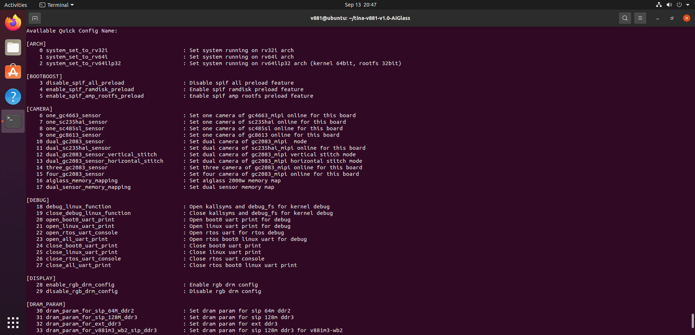
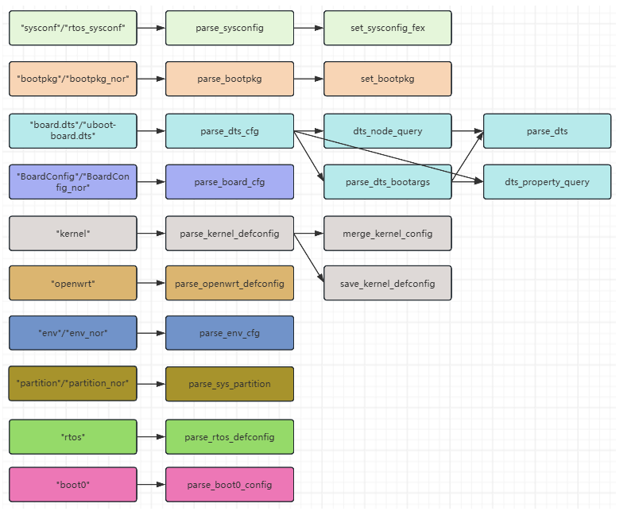

# Quick configuration and optimization

```bash
source build/envsetup.sh
lunch
quick_config
```





Selecting an item and confirming `y` modifies SDK files directly; pressing Enter without selection exits unchanged. Review listed files and additional steps, inspect Git differences, then rebuild/package.

```bash
git status
git diff
quick_config -h
pack
```

Options include `-c/--config` for selected items, `-i/--include` for included files and `-gd/--gen_dts_base` for DTS baselines. `-f/--force` bypasses checks; use only with understood configuration. There is no universal undo; restore changes using the Git diff.

Matching keys are generally overridden from common configuration through includes to board configuration. Avoid JSON trailing commas. After sensor, storage or library-type changes, clean stale output as instructed; check disk/RAM bottlenecks before increasing parallelism.
