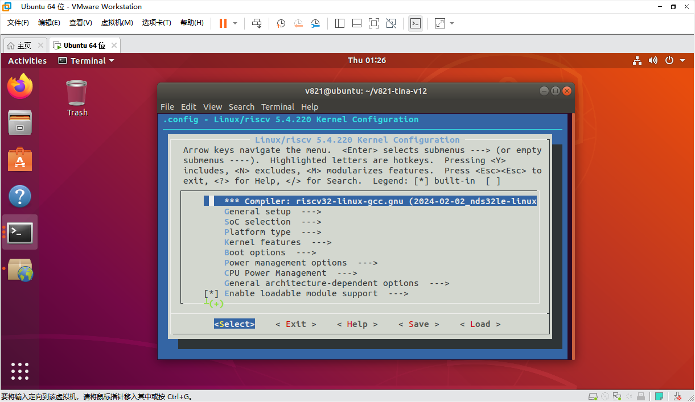
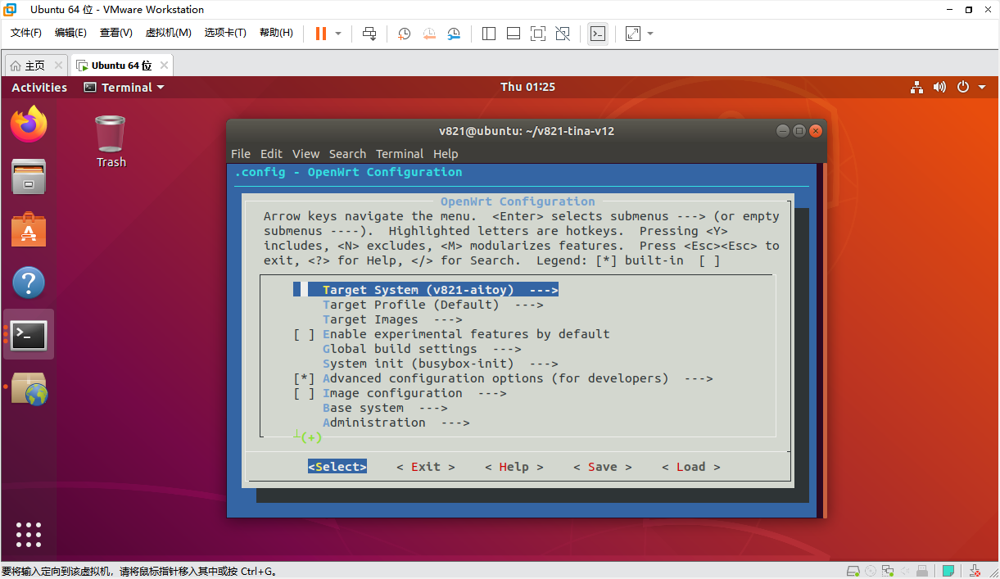
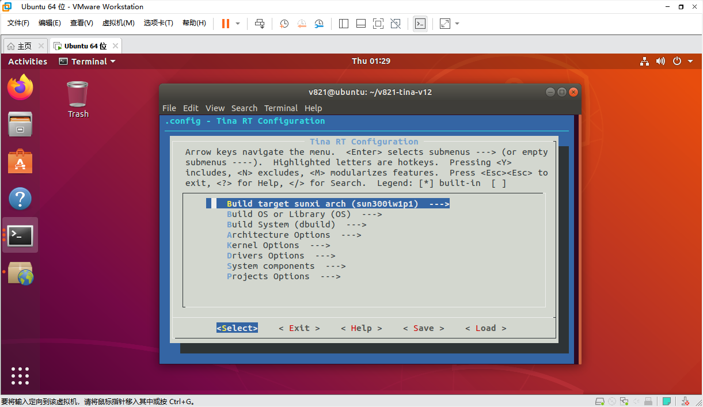

# SDK core configuration

## Configuration menus

```bash
source build/envsetup.sh
lunch
make kernel_menuconfig
make menuconfig
mrtos menuconfig
```







## Device trees and board files

```text
bsp/configs/linux-6.6-xuantie/sun252iw1p1.dtsi
device/config/chips/v861/configs/<board>/linux-6.6-xuantie/board.dts
device/config/chips/v861/configs/<board>/uboot-board.dts
device/config/chips/v861/configs/<board>/sys_config.fex
device/config/chips/v861/configs/<board>/env.cfg
```

Board `board.dts` overrides matching SoC DTS properties. Prefer board-local edits. `sys_config.fex` describes BOOT0 DRAM, pins and storage and takes precedence over conflicting U-Boot DTS settings. `env.cfg` controls boot arguments; fast-boot systems do not use the normal U-Boot environment.

## BOOT0 UART example

```ini
[uart_para]
uart_debug_port = 0
uart_debug_tx = port:PD22<3><1><default><default>
uart_debug_rx = port:PD23<3><1><default><default>

[platform]
debug_mode = 0
```

PD22/PD23 are the documented example; verify board pin multiplexing. `debug_mode=0` disables BOOT0 output and `8` enables all output.

## Partitions and filesystems

```ini
[partition]
name = rootfs
size = 20480
downloadfile = "rootfs.fex"
user_type = 0x8000
```

Non-NOR media use `sys_partition.fex`; NOR uses `sys_partition_nor.fex`. Align sizes to the media, with ordinary sizes expressed in 512-byte sectors. A final UDISK without size consumes remaining space. `downloadfile` is relative to the packaging image directory.

The default read-only rootfs can use squashfs with a writable overlay. The eMMC writable layer typically uses ext4 and NOR uses jffs2. EROFS requires both `CONFIG_TARGET_ROOTFS_EROFS` and kernel `CONFIG_EROFS_FS`, with the squashfs target disabled.
