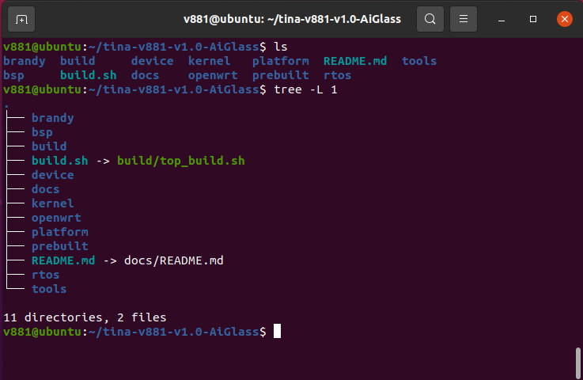

# SDK structure and board selection

The X881 Linux manual names the source archive `tina-v881-v1.0.tar.gz` and board target `v861-9tripod_aiglass-tina`. Internal directories include `v861` configurations and the `linux-6.6-xuantie` kernel. Select the board before locating active configuration files.



```text
brandy/       # BOOT0 and U-Boot
bsp/          # Drivers, headers and DTS
build/        # Build and packaging scripts
device/       # SoC and board configurations
kernel/       # Linux kernel
openwrt/      # Packages and rootfs configuration
out/          # Build output
platform/     # Platform libraries and applications
prebuilt/     # Prebuilt tools
rtos/         # RTOS, components and HAL
test/         # Tests
tools/        # Development utilities
```

## Initialization and navigation

```bash
source build/envsetup.sh
lunch
croot
cconfigs
cplat
cbsp
cboot
crtos
cout
```

`cconfigs` locates active board configuration, `cplat` the OpenWrt board directory and `cout` the output. The manual uses `bga_perf1` as a generic example; edit the selected aiglass board directory for the actual product.
