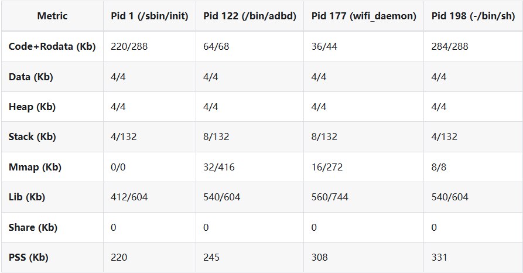
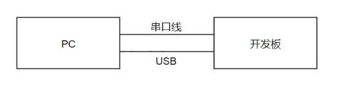
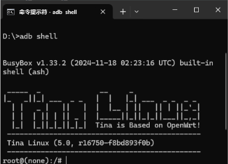

# Memory resources and application debugging

## Memory layout

Plan Linux, RTOS, shared buffers, OpenSBI and multimedia pools together; reserved/no-map regions must not overlap. The manual RV32 example requires 4 MB kernel-start alignment and 128 KB OpenSBI alignment; verify against the active architecture and boot code. Leave space at the memory tail for U-Boot relocation.

```bash
cat /proc/meminfo
free
ramparser -a
ramparser -r
ramparser -s
ramparser -p <pid>
```



Screenshot capacities are tool examples, not board memory specifications. Confirm the actual recording mount before writing files to avoid filling the overlay when external media are absent.

## ADB debugging



Enable `Allwinner → USB → adbd for Tina Linux` in Tina menuconfig. Install platform-tools on the PC, add it to PATH and check connectivity.

```bash
adb version
adb devices
adb shell
adb push <local-file> <board-path>
adb pull <board-path> <local-path>
```



Collect UART, dmesg and process information for failures. Use GDB/VSCode for breakpoints and core dumps for postmortem analysis, with matching toolchains and symbols.
