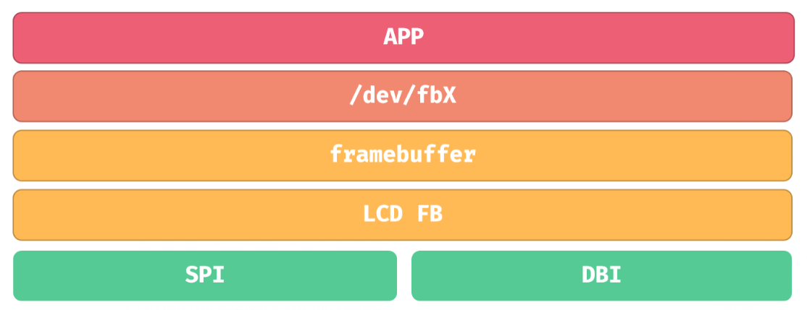
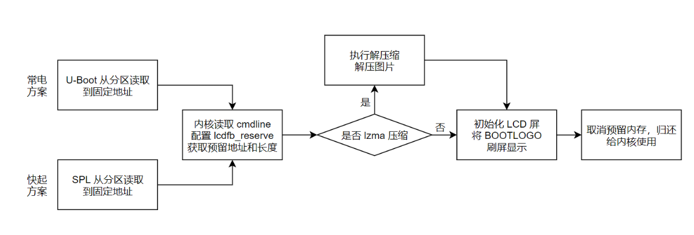

# SPI LCD and boot logo





DBI can provide hardware DC control; lane mode, pixel format, TE and SPI controller depend on the driver. Match the device tree to adapter PD1–PD6, TWI3, reset and backlight connections.

## BOOTLOGO configuration

```text
CONFIG_AW_LCD_FB_DECOMPRESS_LZMA=y
openwrt/target/v881/v881-common/boot-resource/boot-resource/bootlogo.bmp
```

The manual packages the BMP at this path with LZMA compression, requiring the kernel decompressor option. Use the resource directory present in the delivered SDK.

```ini
[partition]
name = bootlogo
size = 256
user_type = 0x8000
downloadfile = bootlogo.fex
```

For an uncompressed logo, update copy/packaging logic in `build/pack` too. Distinguish U-Boot display from kernel LCD_FB display; fast boot omitting U-Boot uses its corresponding kernel path.
