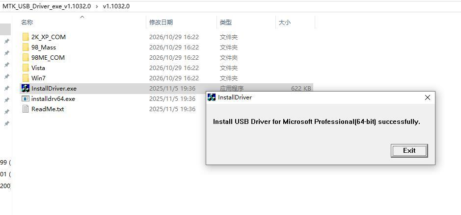
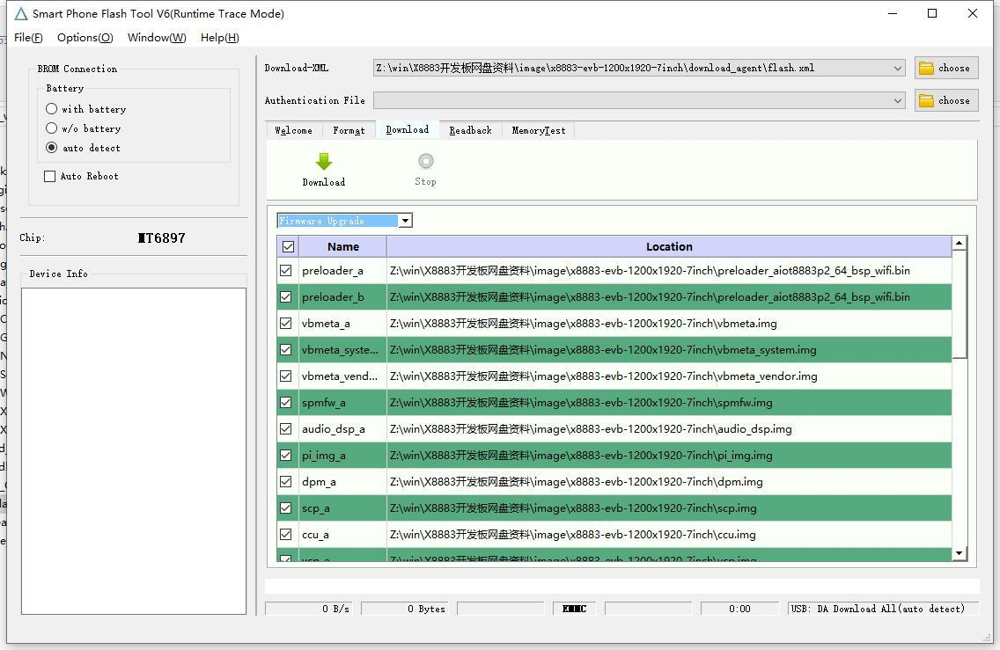
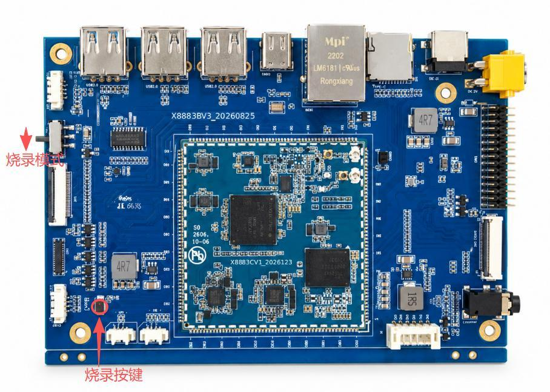
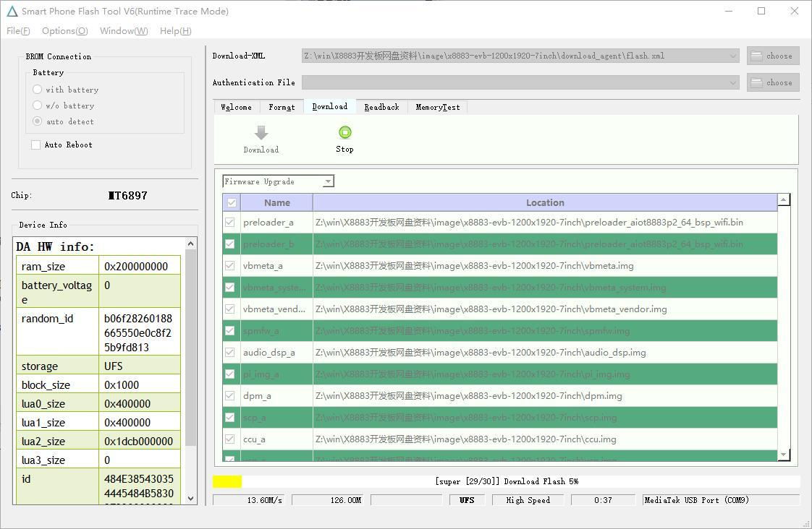

# Android Flashing

## Prepare Driver and Tool

Obtain the Windows flashing tool, USB driver and complete image package matched to the board firmware. Back up required data, the existing firmware and partition table before upgrading. Install the USB driver, open the tool, select the package XML configuration and click **Download** to wait for the board.

## Connect and Flash

1. With the board powered off, connect Type-C J10 to the PC.
2. Move the download switch to flashing mode.
3. Hold the flashing button while applying DC power.
4. Wait for detection and writing to finish. Confirm the success indication before removing power.
5. Restore the normal boot switch position and power up for validation.

Do not connect the parallel battery and DC inputs simultaneously. After flashing, verify display, touch, cameras, USB, Ethernet, audio, TF and sensors. For production firmware, verify MAC address, serial number and region settings.

---

**Reference Documents**

shared-drive folder `x8883-docs` → X8883 Android Platform User Manual V1.0 → Chapter 3, Section 3.4, Firmware Flashing.
