# Android Functional Tests

## LCD, Touch and Backlight

Open the AndroidTest2 LCD test and tap the solid-color area to cycle colors; check for missing colors, bad pixels and image defects. In the touch test, tap Start Test and draw diagonals to check coordinates, discontinuities and edges. Drag the circular control in the backlight test and verify brightness changes.

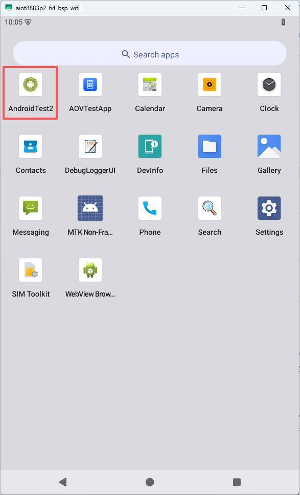

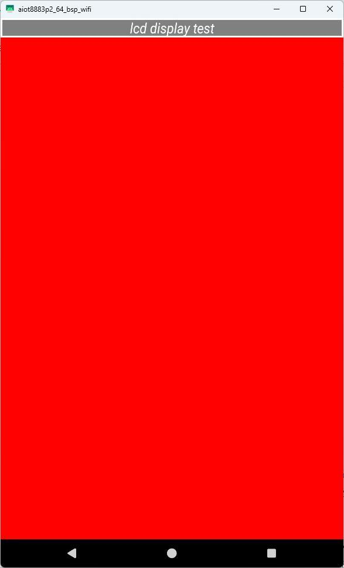

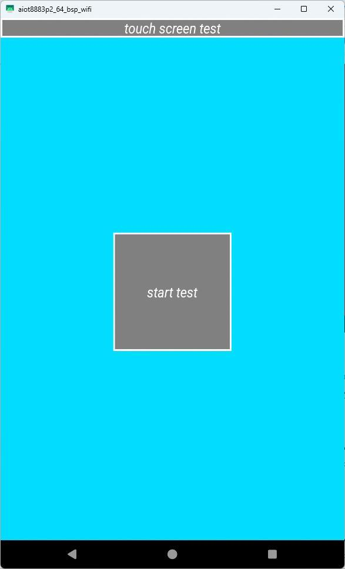

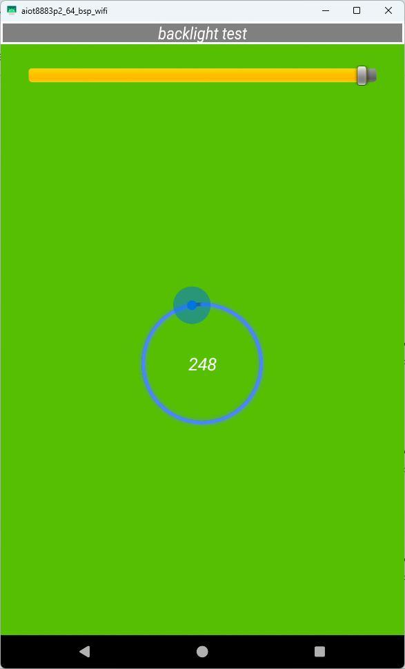

## Camera and Sensors

Open Camera and verify preview, orientation and image stability. In the test app, inspect GSensor, Gyroscope and Magnetic pages. Change the board orientation and observe axis readings; keep surrounding magnetic conditions controlled.

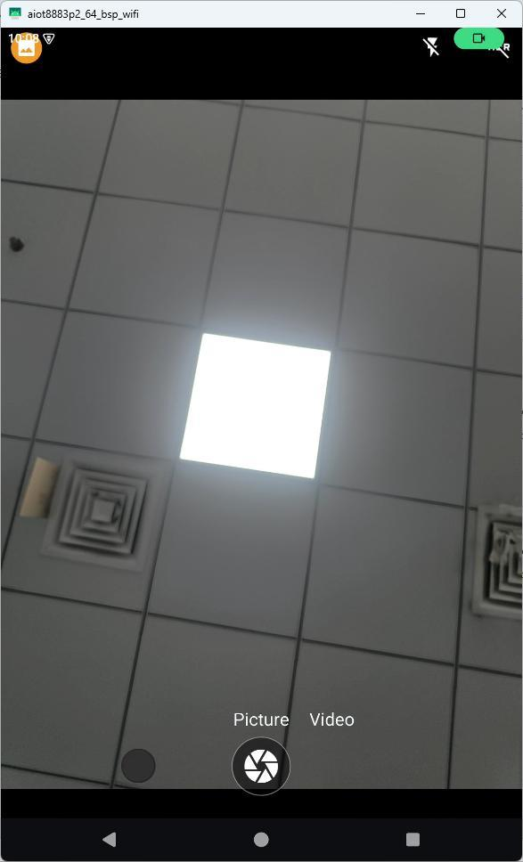

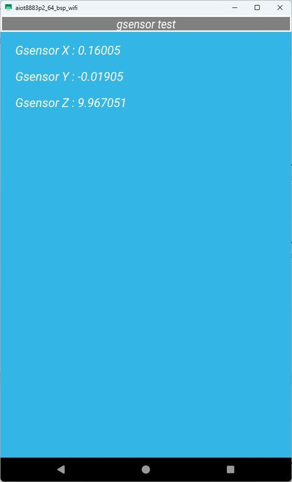

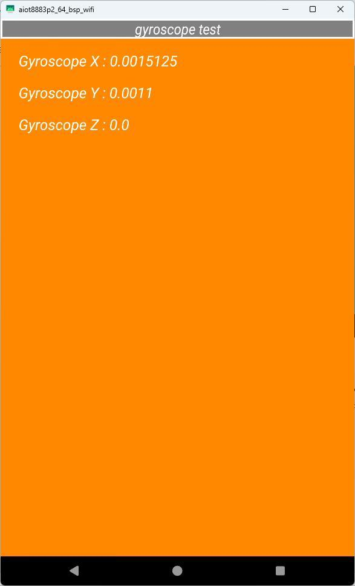

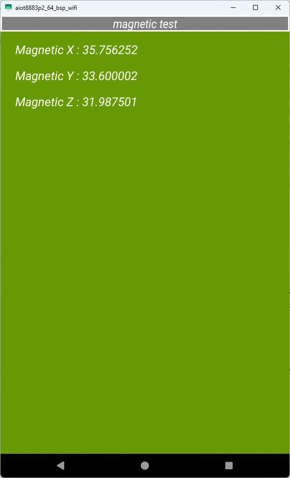

## Wi-Fi, Bluetooth and Ethernet

Wi-Fi: open Settings → Network & Internet / Internet, enable Wi-Fi, connect to an access point and verify network access. Bluetooth: open Settings → Connected devices → Bluetooth, select a discovered device and confirm pairing on both ends. Ethernet: connect an RJ45 cable and inspect Ethernet status and IP settings on the Internet page.

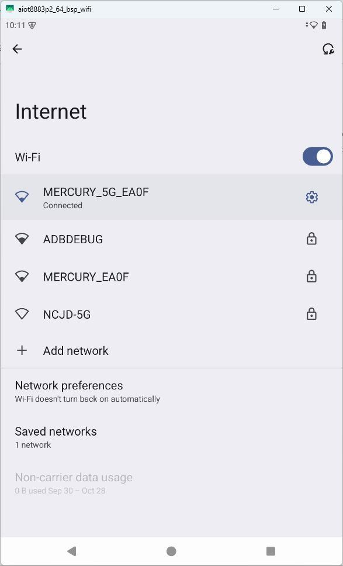

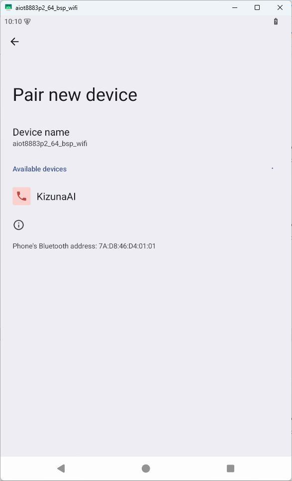

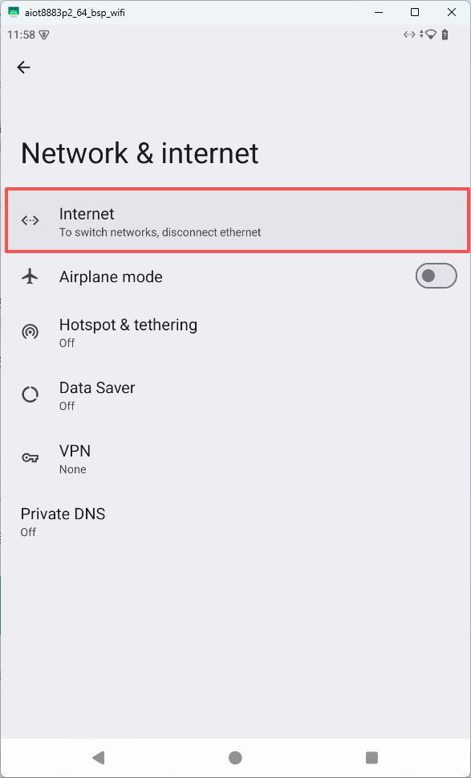

On a host with ADB configured, run the following command to inspect network interface addresses:

```bash
adb shell ifconfig
```

## USB Storage and TF Card

Insert USB storage and check automatic mounting and file access in Files. TF cards are identified by UUID and mounted under `/storage/`. If formatting is requested, proceed only after confirming that existing card data can be erased. Verify reading, writing and recognition after reinsertion.

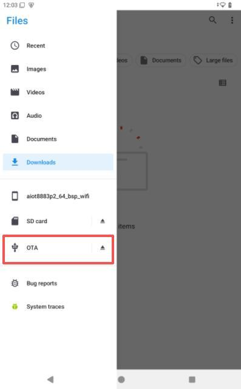

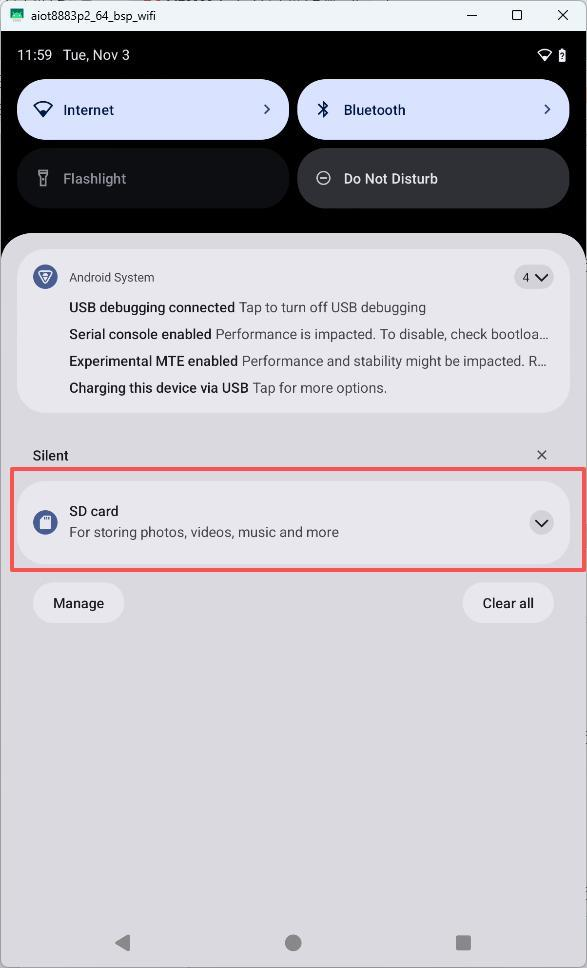

---

**Reference Documents**

shared-drive folder `x8883-docs` → X8883 Android Platform User Manual V1.0 → Chapter 4, Android Functional Tests.
