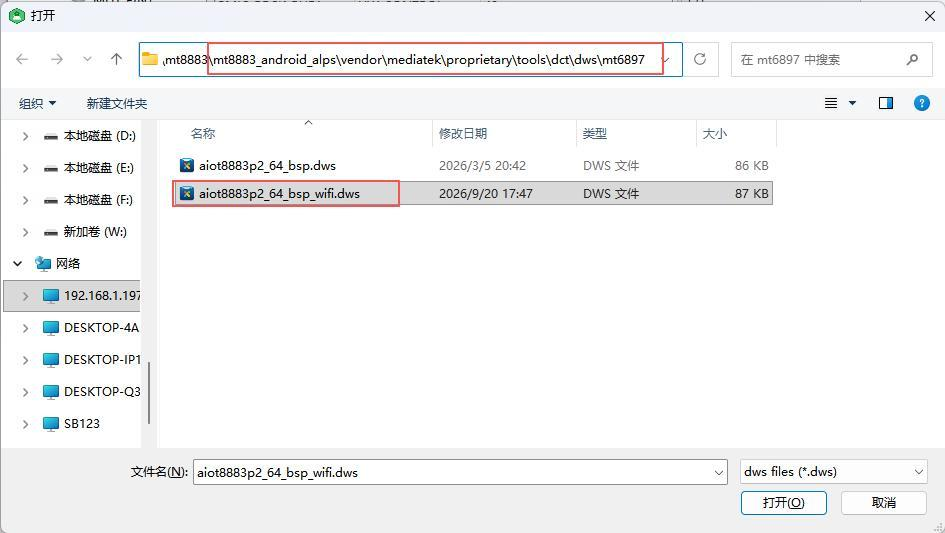
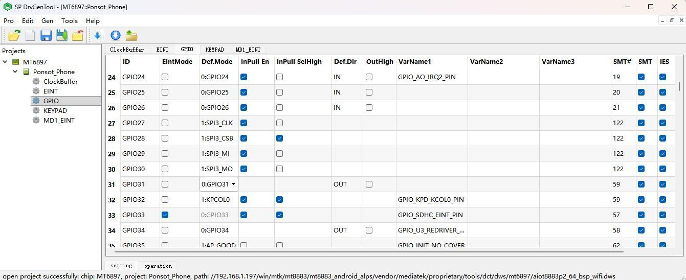

# DTS, GPIO and Buses

Paths are relative to `mt8883_android_alps` and apply to the Kernel 6.1 SDK. Retain `mt6897` in the paths and confirm the project and source revision.

## Device Tree and GPIO Tool

```text
kernel/kernel_device_modules-6.1/arch/arm64/boot/dts/mediatek/mt6897.dts
kernel/kernel_device_modules-6.1/arch/arm64/boot/dts/mediatek/aiot8883p2_64_bsp_wifi.dts
vendor/mediatek/proprietary/tools/dct/dws/mt6897/aiot8883p2_64_bsp_wifi.dws
vendor/mediatek/proprietary/tools/dct/DrvGen.exe
```

Copy DrvGen, the DWS and required companion files to Windows. Open the project DWS, configure GPIO/multiplexing against the schematic and generate configuration using the tool workflow. DCT GPIO numbers are not physical connector pin numbers.





## I2C and PCIe

The I2C example uses `&i2c7`: enable the controller in DTS and add the slave address. If the firmware includes `i2cdetect`, confirm the actual bus before scanning. PCIe requires both `&pcie` and `&pciephy`, with the appropriate pinctrl.

```dts
&pio {
    pcie_pins_default: pcie-default {
        pins-cmd-dat {
            pinmux = <PINMUX_GPIO174__FUNC_PCIE_WAKEN>,
                     <PINMUX_GPIO173__FUNC_PCIE_PERSTN>,
                     <PINMUX_GPIO175__FUNC_PCIE_CLKREQN>;
            bias-pull-up;
        };
    };
};

&pcie {
    pinctrl-names = "default";
    pinctrl-0 = <&pcie_pins_default>;
    l2,bypass;
    status = "okay";
};

&pciephy {
    status = "okay";
};
```

Integrate the configuration into the matching DTS and verify its nodes, macro definitions and properties against the current source tree.

---

**Reference Documents**

shared-drive folder `x8883-docs` → X8883 Android Platform User Manual V1.0 → Chapter 5, Sections 5.1 to 5.2.
