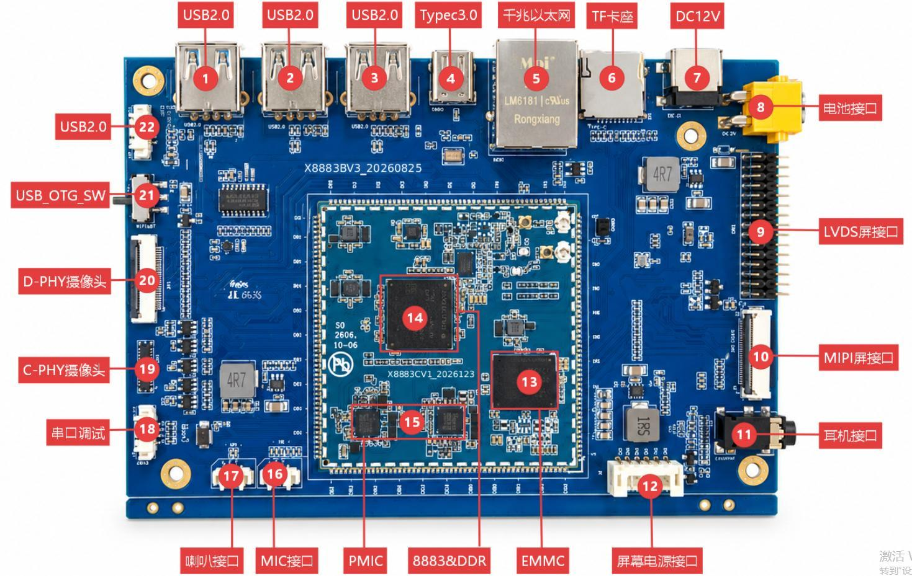

# Hardware Resources

The table identifies each numbered interface and its connector. Verify the board revision and matching schematic before connecting.

| Callout | Function | Connector / Notes |
| --- | --- | --- |
| 1/2/3 | USB 2.0 Host | J22 / J9506 / J9507 |
| 4 | Type-C USB 3.0 OTG | J10 |
| 5 | Gigabit Ethernet | RTL8111H / RJ45 J3 |
| 6 | TF card socket | CN1 / MSDC1 |
| 7 | 12 V DC input | J1 |
| 8 | 12 V battery input | Parallel with DC input; do not connect both |
| 9 | LVDS display | J17, 30-pin, 2.0 mm |
| 10 | MIPI display | U39, 30-pin, 0.5 mm FPC |
| 11 | Headphones | 3.5 mm |
| 12 | Display power | CN2, 6-pin, 2.0 mm |
| 13 | Storage device | Check the delivered configuration |
| 14 | CPU + PoP memory | MT8883 / LPDDR |
| 15 | PMIC | Core-board power management |
| 16 | Microphone | MIC1, 2-pin, 1.25 mm |
| 17 | Speaker | AW8898; 4 Ω / 3 W |
| 18 | Debug UART | J21, 4-pin, 2.54 mm |
| 19 | C-PHY camera | CON3 |
| 20 | D-PHY camera | J16, 26-pin, 0.5 mm |
| 21 | USB_OTG_SW | ASW7227 path selection |
| 22 | USB 2.0 Host | J9505, Type-A |

---

**Reference Documents**

shared-drive folder `x8883-docs` → X8883 Development Board Hardware Manual → Chapter 2, Core Board Connectors, and Chapter 3, Onboard Interfaces and Connectors.
