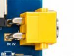
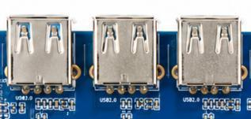
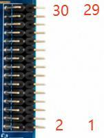

# Onboard Interface Definitions

The following tables define the carrier connectors. Use the schematic matching the board revision to verify pins before wiring or revising the carrier.

## Power, USB, Ethernet and TF

J1 is a 2-pin 12 V DC input; use an adapter rated for at least 12 V/2 A. Callout 8 accepts a 12 V battery pack and is directly parallel with J1: **do not connect both inputs at the same time**. J22/J9506/J9507 are USB 2.0 Host ports, with a recommended maximum 500 mA per port; J9505 is an additional Host port. J10 Type-C supports USB 3.0 OTG, flashing, ADB and DP Alt Mode.

RJ45 J3 provides 10/100/1000 M Ethernet through the PCIe-connected RTL8111H. Route MDI at 100 Ω differential and verify magnetics, shielding and termination. CN1 is an MSDC1 4-bit TF socket supporting SD/SDHC/SDXC. Route CLK/DATA/CMD at 50 Ω and provide card detection, debounce and ESD protection. Route USB 2.0 at 90 Ω differential and protect/current-limit VBUS.

## LVDS J17

| Pin | Signal | Description |
| --- | --- | --- |
| 1 | LVDS_VCC | Panel power |
| 2 | LVDS_VCC | Panel power |
| 3 | GND | Ground |
| 4 | GND | Ground |
| 5 | GND | Ground |
| 6 | GND | Ground |
| 7 | LVDS_D0_A_N | Channel A D0- |
| 8 | LVDS_D0_A_P | Channel A D0+ |
| 9 | LVDS_D1_A_N | Channel A D1- |
| 10 | LVDS_D1_A_P | Channel A D1+ |
| 11 | LVDS_D2_A_N | Channel A D2- |
| 12 | LVDS_D2_A_P | Channel A D2+ |
| 13 | GND | Ground |
| 14 | GND | Ground |
| 15 | LVDS_CLK_A_N | Channel A  clock- |
| 16 | LVDS_CLK_A_P | Channel A  clock+ |
| 17 | LVDS_D3_A_N | Channel A D3- |
| 18 | LVDS_D3_A_P | Channel A D3+ |
| 19 | LVDS_D0_B_N | Channel B D0- |
| 20 | LVDS_D0_B_P | Channel B D0+ |
| 21 | LVDS_D1_B_N | Channel B D1- |
| 22 | LVDS_D1_B_P | Channel B D1+ |
| 23 | LVDS_D2_B_N | Channel B D2- |
| 24 | LVDS_D2_B_P | Channel B D2+ |
| 25 | GND | Ground |
| 26 | GND | Ground |
| 27 | LVDS_CLK_B_N | Channel B  clock- |
| 28 | LVDS_CLK_B_P | Channel B  clock+ |
| 29 | LVDS_D3_B_N | Channel B D3- |
| 30 | LVDS_D3_B_P | Channel B D3+ |

30-pin, 2.0 mm, dual-channel LVDS at 100 Ω differential. Keep backlight power separate from signals.

## MIPI Display U39

| Pin | Signal | Description |
| --- | --- | --- |
| 1 | VDD_5V0 | Display 5 V |
| 2 | VDD_5V0 | Display 5 V |
| 3 | VDD_5V0 | Display 5 V |
| 4 | EXT_3V3 | Display 3.3 V |
| 5 | EXT_3V3 | Display 3.3 V |
| 6 | I2C4_SCL_M3_TP | Touch I2C clock |
| 7 | I2C4_SDA_M3_TP | Touch I2C data |
| 8 | TP_INT_L | Touch interrupt |
| 9 | TP_RST_L | Touch reset |
| 10 | GND | Ground |
| 11 | EXT_3V3 | Display 3.3 V |
| 12 | GND | Ground |
| 13 | CD_RESET | Display reset |
| 14 | GND | Ground |
| 15 | LCD_PWREN | Display power enable |
| 16 | GND | Ground |
| 17 | MIPI_DPHY0_TX_3N | MIPIlane3- |
| 18 | MIPI_DPHY0_TX_3P | MIPIlane3+ |
| 19 | GND | Ground |
| 20 | MIPI_DPHY0_TX_2N | MIPIlane2- |
| 21 | MIPI_DPHY0_TX_2P | MIPIlane2+ |
| 22 | GND | Ground |
| 23 | MIPI_DPHY0_TX_CLKN | MIPI clock- |
| 24 | MIPI_DPHY0_TX_CLKP | MIPI clock+ |
| 25 | GND | Ground |
| 26 | MIPI_DPHY0_TX_1N | MIPIlane1- |
| 27 | MIPI_DPHY0_TX_1P | MIPIlane1+ |
| 28 | GND | Ground |
| 29 | MIPI_DPHY0_TX_0N | MIPIlane0- |
| 30 | MIPI_DPHY0_TX_0P | MIPIlane0+ |
| 31/32 | GND | FPC shield / mounting pins |

30-pin, 0.5 mm FPC; 31/32 are shield/mounting pins. Carries four-lane D-PHY, touch, controls and display power; route at 100 Ω differential.

## Display Power CN2

| Pin | Signal | Description |
| --- | --- | --- |
| 1 | GND | Ground |
| 2 | LCD-PWM | Backlight PWM |
| 3 | LCD_EN | Display enable |
| 4 | VCC12V_DCIN | 12 V display power |
| 5 | VCC12V_DCIN | 12 V display power |
| 6 | VCC12V_DCIN | 12 V display power |

## MIC1

| Pin | Signal | Description |
| --- | --- | --- |
| 1 | MIC_N | Microphone negative |
| 2 | MIC_P | Microphone positive |

2-pin, 1.25 mm analog microphone. Keep away from inductors and high-speed noise; place bias/filter components near the microphone.

## Speaker

| Pin | Signal | Description |
| --- | --- | --- |
| 1 | SPK- | Speaker negative |
| 2 | SPK+ | Speaker positive |

2-pin, 1.25 mm output from the AW8898 amplifier, specified for a 4 Ω/3 W speaker.

## Debug UART J21

| Pin | Signal | Description |
| --- | --- | --- |
| 1 | GND | Ground |
| 2 | UART_RX | Core-board RX |
| 3 | UART_TX | Core-board TX |
| 4 | 3V3 | 3.3 V reference |

4-pin, 2.54 mm; the carrier interface is 3.3 V TTL, default 115200-8-N-1. Cross TX/RX.

## C-PHY Camera CON3

| Pin | Signal | Description |
| --- | --- | --- |
| 1 | AF_GND | Autofocus ground |
| 2 | AGND | Analog ground |
| 3 | AGND | Analog ground |
| 4 | DGND | Digital ground |
| 5 | DGND | Digital ground |
| 6 | DGND | Digital ground |
| 7 | DGND | Digital ground |
| 8 | MCP-C1 | CSI0A_L2N |
| 9 | MCN-B1 | CSI0A_L2P |
| 10 | MDP1-A1 | CSI0A_L1N |
| 11 | DGND | Digital ground |
| 12 | DGND | Digital ground |
| 13 | NC | Reserved |
| 14 | DGND | Digital ground |
| 15 | PWDN_NC | Camera PWDN |
| 16 | RESET | Camera reset |
| 17 | VSYNC | Frame sync |
| 18 | MCLK | Camera master clock |
| 19 | DGND | Digital ground |
| 20 | DGND | Digital ground |
| 21 | DVDD1V1 | 1.1 V digital power |
| 22 | DVDD1V1 | 1.1 V digital power |
| 23 | DOVDD1V8 | 1.8 V I/O power |
| 24 | SCL | I2C clock |
| 25 | SDA | I2C data |
| 26 | DGND | Digital ground |
| 27 | DGND | Digital ground |
| 28 | MDN2-A2 | CSI0B_L0P |
| 29 | MDP2-B2 | CSI0B_L0N |
| 30 | MDN3-C2 | CSI0B_L1P |
| 31 | DGND | Digital ground |
| 32 | DGND | Digital ground |
| 33 | DGND | Digital ground |
| 34 | MDN0-A0 | CSI0A_L0P |
| 35 | MDP0-B0 | CSI0A_L0N |
| 36 | MDN1-C0 | CSI0A_L1P |
| 37 | DGND | Digital ground |
| 38 | AVDD1V8 | 1.8 V analog power |
| 39 | AVDD2V8 | 2.8 V analog power |
| 40 | AF_VDD2V8 | Autofocus 2.8 V |

CON3 is a 44-pin connector; the table lists pins 1 through 40. Consult the matching schematic before connecting pins 41 through 44. Carrier LDOs supply the camera; configure sequencing for the module.

## D-PHY Camera J16

| Pin | Signal | Description |
| --- | --- | --- |
| 1 | GND | Ground |
| 2 | MIPI_CLKP | MIPI clock+ |
| 3 | MIPI_CLKN | MIPI clock- |
| 4 | GND | Ground |
| 5 | MIPI_D0P | MIPIlane0+ |
| 6 | MIPI_D0N | MIPIlane0- |
| 7 | GND | Ground |
| 8 | MIPI_D1P | MIPIlane1+ |
| 9 | MIPI_D1N | MIPIlane1- |
| 10 | GND | Ground |
| 11 | MIPI_D2P | MIPIlane2+ |
| 12 | MIPI_D2N | MIPIlane2- |
| 13 | GND | Ground |
| 14 | MIPI_D3P | MIPIlane3+ |
| 15 | MIPI_D3N | MIPIlane3- |
| 16 | GND | Ground |
| 17 | SDA | Camera I2C data |
| 18 | SCL | Camera I2C clock |
| 19 | RESET | Camera reset |
| 20 | PWDN | Camera PWDN |
| 21 | XCLK | Camera master clock |
| 22 | DOVDD1.8 | 1.8 V I/O power |
| 23 | AVDD2.8 | 2.8 V analog power |
| 24 | AF_VDD | Autofocus power |
| 25 | DVDD1.2 | 1.2 V digital power |
| 26 | GND | Ground |

26-pin, 0.5 mm FPC with four-lane MIPI, clock, control and camera supply rails.

## USB_OTG_SW

| Pin | Signal | Description |
| --- | --- | --- |
| 1 | USB_SW | OTG/HOST selection |
| 2 | GND | Ground |

USB_SW is grounded or left open to control the ASW7227 OTG/HOST path. Select the download position specified by the flashing instructions.

## USB 2.0 J9505

| Pin | Signal | Description |
| --- | --- | --- |
| 1 | VBUS | 5 V output |
| 2 | D- | USB 2.0 negative |
| 3 | D+ | USB 2.0 positive |
| 4 | GND | Ground |

Pins 5/6 are shield/mounting pins.

---

**Reference Documents**

shared-drive folder `x8883-docs` → X8883 Development Board Hardware Manual → Chapter 3, Onboard Interfaces and Connectors.
