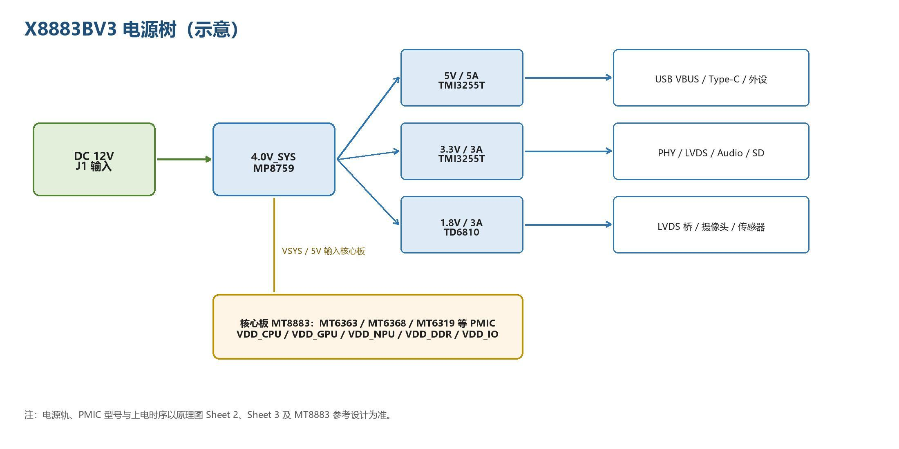

# Power and Debug

The 12 V input passes through protection to form VCC12V_DCIN. MP8759 generates 4.0V_SYS, TMI3255T generates 5 V/3.3 V, and TD6810 generates 1.8 V. Core-board PMICs generate CPU/GPU/NPU/DDR/I/O rails. Do not connect the mainboard 12 V input directly to core-board VSYS.

| Rail | Typical Value | Load |
| --- | --- | --- |
| VCC12V_DCIN | 12 V | Input |
| 4.0V_SYS | 4.0 V | Main system supply |
| 5V | 5 V | USB, LVDS, audio |
| 3.3V | 3.3 V | PHY, peripherals, connectors |
| 1.8V | 1.8 V | LVDS bridge, camera, sensors |

## Clocks, Reset and Thermal Design

The core board provides 26/52 MHz reference clocks; RTL8111H uses a 25 MHz crystal and the LVDS bridge uses a 12 MHz crystal. Check startup in this order: 12 V → 4.0V_SYS → 5V/3.3V/1.8V → VSYS → PMIC → reset release. Avoid I/O back-powering during shutdown. Provide suitable cooling for high loads, keep antennas away from power/high-speed routes and perform load and temperature testing.

## UART Logs

Use J21 (3.3 V TTL), with GND/RX/TX/3V3 as listed in the connector table. Connect PC TX to board RX and PC RX to board TX; default 115200-8-N-1. These ratings apply to carrier J21 and do not replace the bare core-board I/O requirements. Capture complete boot logs before diagnosing peripherals.

---

**Reference Documents**

shared-drive folder `x8883-docs` → X8883 Development Board Hardware Manual → Chapter 4, Power, Clocks and Reset, and Chapter 5, Software Resources.
