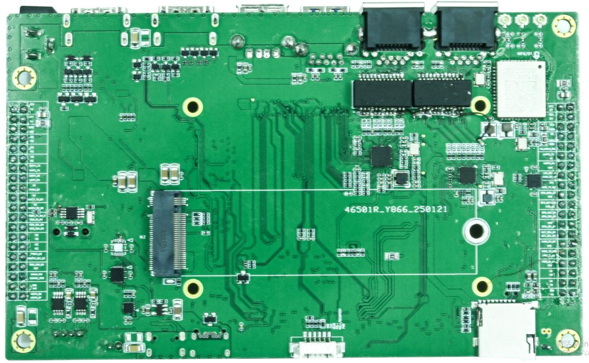
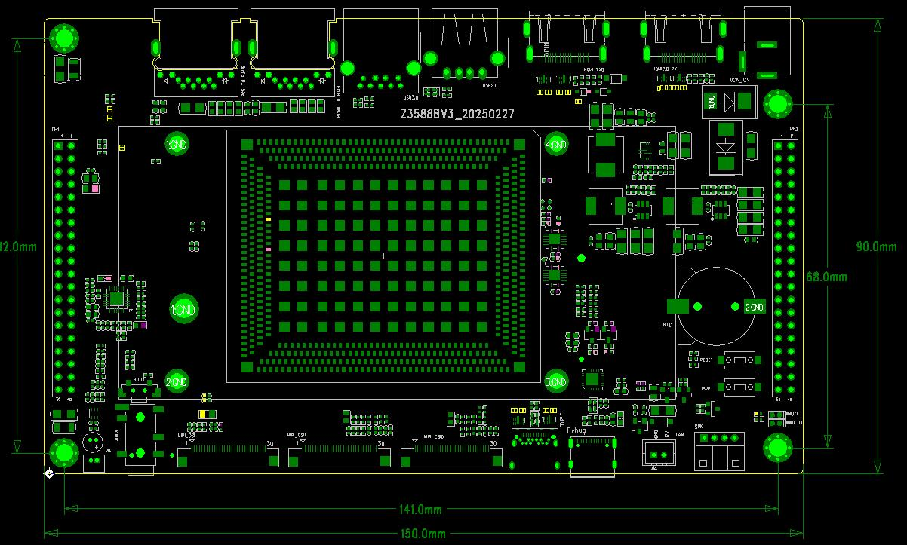

# Hardware Resources

## Front and Rear Views

The rear carries the Wi-Fi/Bluetooth module, TF card slot, 6-pin external key header and M.2 connector.

## Main Hardware Resources

| Function | Hardware | Description |
| --- | --- | --- |
| Processor | RK3588 | Eight-core CPU with GPU and NPU |
| Power management | RK806-2 | Dynamic frequency scaling, 12 V board input |
| Display | HDMI IN, HDMI OUT, MIPI DSI | MIPI DSI shares resources with LVDS. Verify the panel interface before configuration. |
| Camera | Two MIPI CSI connectors | For MIPI camera modules |
| Networking | RTL8211F, RTL8111 | Two Gigabit Ethernet ports, the second via PCIe |
| Wireless | VS2275P | Wi-Fi 6 and Bluetooth 5.3 |
| Storage | eMMC, TF, M.2 | Onboard eMMC, TF boot or storage and M.2 expansion |
| USB | USB 2.0, USB 3.0, Type-C OTG | Type-C OTG supports flashing and ADB |
| Audio | MIC, headphones and speaker | Check the connector pinout and fitted amplifier rating |
| Debug | Type-C DEBUG | Serial logs and debugging |
| Cooling | 12 V fan connector | 2-pin, GND / 12 V |
| RTC | 3 V coin-cell holder | Keeps RTC time while main power is off |

## Connector Locations

See [Hardware Interface Definitions](./z3588bv3-interface-details.md) for the front and rear callouts. Check the silkscreen and pin table for connector voltages and pin 1 orientation before wiring.
