# Hardware Interface Definitions

## Front Interface Layout

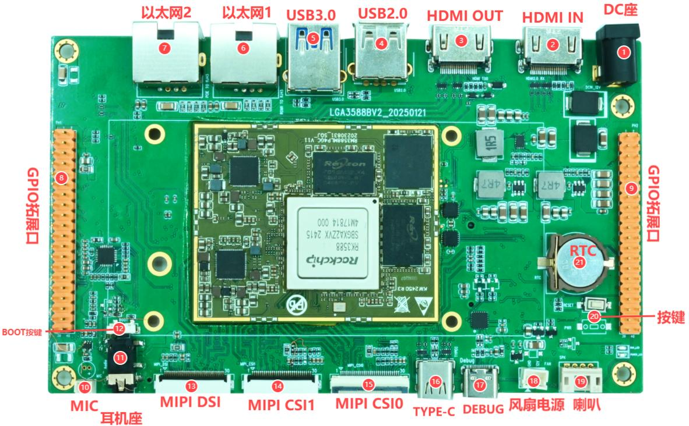

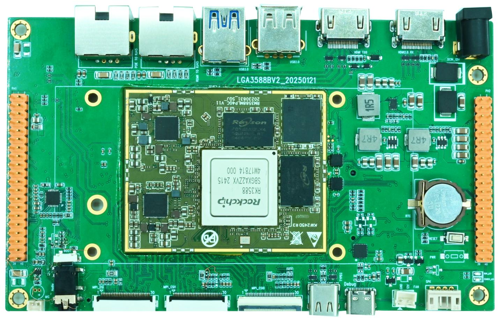

| Callout | Interface | Description |
| --- | --- | --- |
| 1 | DC input | 12 V DC input |
| 2 | HDMI IN | HDMI input |
| 3 | HDMI OUT | HDMI output |
| 4 | USB 2.0 | Type-A Host |
| 5 | USB 3.0 | Type-A Host |
| 6 | Ethernet 1 | Gigabit Ethernet via RGMII, RTL8211F |
| 7 | Ethernet 2 | Gigabit Ethernet via PCIe, RTL8111 |
| 8 | GPIO header 1 | Left in the front overview, 2×20 at 2.54 mm pitch |
| 9 | GPIO header 2 | Right in the front overview, 2×20 at 2.54 mm pitch |
| 10 | MIC | 2-pin, 1.25 mm recording input |
| 11 | Headphone jack | Headphones or headset |
| 12 | BOOT | Download key |
| 13 | MIPI DSI | MIPI display connector |
| 14 | MIPI CSI1 | Camera connector between DSI and CSI0 |
| 15 | MIPI CSI0 | Camera connector next to Type-C OTG |
| 16 | Type-C | OTG, flashing and ADB |
| 17 | DEBUG | Type-C serial debug connector |
| 18 | Fan | 12 V fan supply |
| 19 | Speaker | 4-pin, 2.0 mm right-angle PH connector |
| 20 | Keys | Reset and power keys |
| 21 | RTC | RTC battery connector |

## Rear Interface Layout

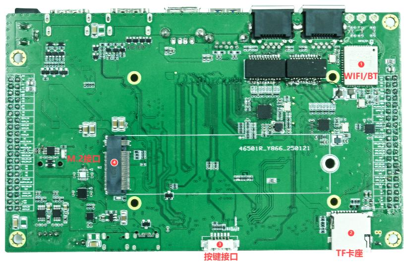

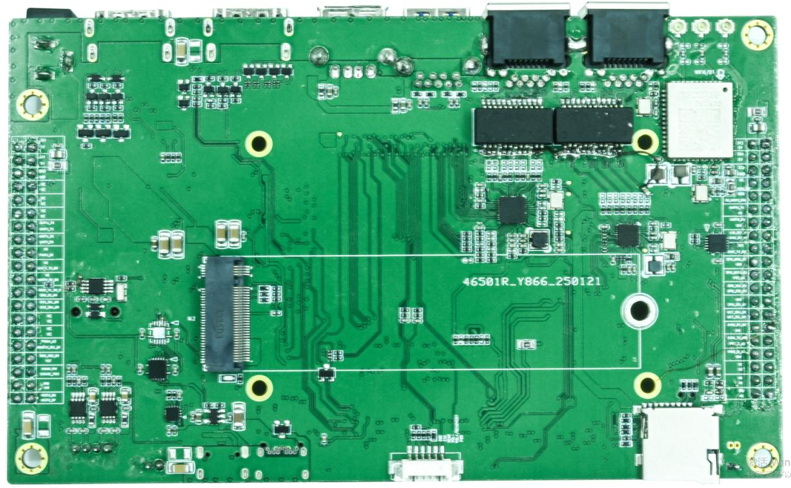

| Callout | Interface | Description |
| --- | --- | --- |
| 1 | Wi-Fi/BT | Onboard wireless module |
| 2 | TF card | TF card slot |
| 3 | External keys | 6-pin, 1.25 mm key header |
| 4 | M.2 | M.2 storage connector |

## Power Input

The board uses 12 V DC. Use a 12 V / 3 A adapter as specified in the hardware interface section. The package list shows 12 V / 2 A, so confirm available current before using that adapter.

## HDMI

HDMI IN and HDMI OUT use standard Type-A connectors and connect to native RK3588 interfaces. Capture and display capabilities depend on the SDK, device tree and drivers.

## USB

- USB 3.0: one Type-A Host port for drives and peripherals.
- USB 2.0: one Type-A Host port.
- Type-C: OTG port for flashing and ADB.

## Ethernet and Wireless

- Ethernet 1: RTL8211F Gigabit Ethernet via GMAC/RGMII.
- Ethernet 2: RTL8111 Gigabit Ethernet via PCIe.
- Wi-Fi/BT: VS2275P module, specified for Wi-Fi 6 and Bluetooth 5.3.

## GPIO Expansion Headers

Each header has 2×20 pins at 2.54 mm pitch. Leave pins marked `NC` unused.

### GPIO Header 1 (Front Callout 8)

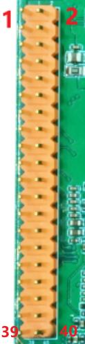

| Pin | Signal | Pin | Signal |
| ---: | --- | ---: | --- |
| 1 | 3.3V | 2 | 5V |
| 3 | I2C4_SDA_M1 (3.3V) | 4 | 5V |
| 5 | I2C4_SCL_M1 (3.3V) | 6 | GND |
| 7 | NC | 8 | UART2_RX_M0 (3.3V) |
| 9 | GND | 10 | UART2_TX_M0 (3.3V) |
| 11 | UART6_TX_M1 (3.3V) | 12 | NC |
| 13 | UART6_RX_M1 (3.3V) | 14 | GND |
| 15 | GPIO4_B0_D (3.3V) | 16 | CAN2_RX_M0 (3.3V) |
| 17 | 3.3V | 18 | CAN2_TX_M0 (3.3V) |
| 19 | SPI0_MOSI_M2 (1.8V) | 20 | GND |
| 21 | SPI0_MISO_M2 (1.8V) | 22 | GPIO4_C2_D (3.3V) |
| 23 | SPI0_CLK_M2 (1.8V) | 24 | SPI0_CS0_M2 (1.8V) |
| 25 | GND | 26 | SPI0_CS1_M2 (3.3V) |
| 27 | I2C7_SDA_M0 (3.3V) | 28 | I2C7_SCL_M0 (3.3V) |
| 29 | NC | 30 | GND |
| 31 | NC | 32 | GPIO1_A7_U (3.3V) |
| 33 | GPIO1_D7_U (3.3V) | 34 | GND |
| 35 | NC | 36 | NC |
| 37 | NC | 38 | NC |
| 39 | GND | 40 | NC |

### GPIO Header 2 (Front Callout 9)

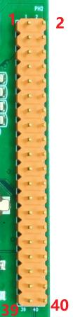

| Pin | Signal | Pin | Signal |
| ---: | --- | ---: | --- |
| 1 | 5V | 2 | 12V |
| 3 | 5V | 4 | 12V |
| 5 | GND | 6 | GND |
| 7 | NC | 8 | NC |
| 9 | NC | 10 | NC |
| 11 | NC | 12 | NC |
| 13 | UART1_TX_M1 (3.3V) | 14 | UART4_TX_M0 (3.3V) |
| 15 | UART1_RX_M1 (3.3V) | 16 | UART4_RX_M0 (3.3V) |
| 17 | GPIO4_B6_D (3.3V) | 18 | NC |
| 19 | UART6_TX_M0 (3.3V) | 20 | NC |
| 21 | UART6_RX_M0 (3.3V) | 22 | NC |
| 23 | GPIO2_B0_U (3.3V) | 24 | GPIO4_B2_U (3.3V) |
| 25 | I2C6_SDA_M0 (3.3V) | 26 | I2C6_SCL_M0 (3.3V) |
| 27 | NC | 28 | NC |
| 29 | NC | 30 | NC |
| 31 | GPIO3_C6_U (3.3V) | 32 | GPIO1_D6_U (3.3V) |
| 33 | RESET_L | 34 | GPIO2_B2_U (3.3V) |
| 35 | SARADC_VIN3 (1.8V) | 36 | SARADC_VIN2 (1.8V) |
| 37 | GND | 38 | GND |
| 39 | USB20_HOST0_DP | 40 | USB20_HOST0_DM |

**Signal levels.** The headers include both 1.8 V and 3.3 V signals. SPI0_MOSI/MISO/CLK/CS0 and SARADC_VIN2/VIN3 are specified at 1.8 V. Check the I/O voltage and pin multiplexing before connecting peripherals.

## Microphone, Headphones and Speaker

### MIC (Front Callout 10)

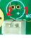

2-pin, 1.25 mm. Pin 1 = MIC, pin 2 = GND.

### Headphone Jack (Front Callout 11)

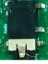

Onboard headphone and headset jack.

### Speaker (Front Callout 19)

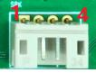

4-pin, 2.0 mm PH connector. Pin 1 = OUT1A, pin 2 = OUT1B, pin 3 = OUT2A, pin 4 = OUT2B. Confirm speaker power against the fitted amplifier. Both outputs are differential. Keep OUTxA and OUTxB isolated from ground.

## MIPI DSI (Front Callout 13)

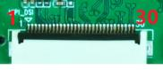

The 30-pin MIPI DSI connector shares resources with LVDS. Use one display mode at a time.

| Pin | Signal | Pin | Signal |
| ---: | --- | ---: | --- |
| 1 | VCC_5V0 | 16 | GND |
| 2 | VCC_5V0 | 17 | MIPI_DPHY0_TX_D3N |
| 3 | VCC_5V0 | 18 | MIPI_DPHY0_TX_D3P |
| 4 | VCC3V3_S3 | 19 | GND |
| 5 | VCC3V3_S3 | 20 | MIPI_DPHY0_TX_D2N |
| 6 | I2C4_SCL_M1 | 21 | MIPI_DPHY0_TX_D2P |
| 7 | I2C4_SDA_M1 | 22 | GND |
| 8 | TP_INT_L | 23 | MIPI_DPHY0_TX_CLKN |
| 9 | TP_RST_L | 24 | MIPI_DPHY0_TX_CLKP |
| 10 | VCC3V3_S3 | 25 | GND |
| 11 | VCC3V3_S3 | 26 | MIPI_DPHY0_TX_D1N |
| 12 | PWM15_M2 | 27 | MIPI_DPHY0_TX_D1P |
| 13 | LCD_RST_H | 28 | GND |
| 14 | NC | 29 | MIPI_DPHY0_TX_D0N |
| 15 | LCD_BL_EN_H | 30 | MIPI_DPHY0_TX_D0P |

## MIPI CSI

### MIPI CSI1 (Front Callout 14)

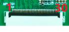

### MIPI CSI0 (Front Callout 15)

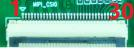

### 30-Pin Signal Definitions

The available documentation contains one CSI pin table. Before wiring CSI1 or CSI0, verify the pin order, supplies and signals against the schematic for that connector.

| Pin | Signal | Pin | Signal |
| ---: | --- | ---: | --- |
| 1 | GND | 16 | GND |
| 2 | MIPI_CSI_RX_CLK0P | 17 | MIPI_CSI_RX_CLK1P |
| 3 | MIPI_CSI_RX_CLK0N | 18 | MIPI_CSI_RX_CLK1N |
| 4 | GND | 19 | MIPI_AF |
| 5 | MIPI_CSI_RX_D0P | 20 | I2C3_SCL_M0_MIPI |
| 6 | MIPI_CSI_RX_D0N | 21 | I2C3_SDA_M0_MIPI |
| 7 | GND | 22 | MIPI_CAM3_CLKOUT |
| 8 | MIPI_CSI_RX_D1P | 23 | SDIO_CLK_M0_WIFI |
| 9 | MIPI_CSI_RX_D1N | 24 | SDIO_D3_M0_WIFI |
| 10 | GND | 25 | MIPI_CAM3_PDN_L |
| 11 | MIPI_CSI_RX_D2P | 26 | CAM_RST |
| 12 | MIPI_CSI_RX_D2N | 27 | CAM_RST |
| 13 | GND | 28 | VCC1V8_CAM |
| 14 | MIPI_CSI_RX_D3P | 29 | VCC2V8_CAM |
| 15 | MIPI_CSI_RX_D3N | 30 | MIPI_1.2V_CAM |

## Type-C, DEBUG and Keys

Use Type-C OTG for flashing and ADB. The other Type-C connector is DEBUG for serial access. Check the board documentation and use the matching debug cable, signal levels, baud rate and pinout.

### External Key Header (Rear Callout 3)

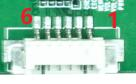

The external key header has six pins at 1.25 mm pitch.

| Pin | Signal |
| ---: | --- |
| 1 | PWRON_L |
| 2 | VOL+/RECOVERY |
| 3 | VOL- |
| 4 | MENU_KEY |
| 5 | ESC_KEY |
| 6 | GND |

## Fan, TF, M.2 and RTC

### Fan (Front Callout 18)

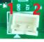

2-pin. Pin 1 = GND, pin 2 = 12V.

### TF Card Slot (Rear Callout 2)

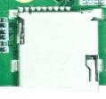

Use TF for boot or file storage as supported by the firmware. Android exposes detected storage under `/storage/`.

### M.2 and RTC

- M.2: storage connector. Confirm keying, protocol, module size and supply capacity before selecting a drive.
- RTC: 3 V coin-cell holder for keeping time while main power is off.
